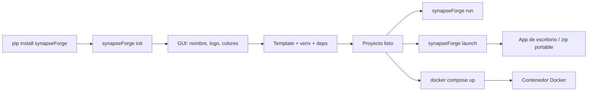

<p align="center">
  
</p>

---

<h1 align="center">
  
</h1>

---

<p align="center">
  <a href="./LICENSE">
    
  </a>
  &nbsp;
  <a href="https://link.mercadopago.com.ar/synapseforge">
    
  </a>
</p>

---

<h3 align="center">Forjá agentes. Distribuí inteligencia.</h3>

---

<p align="center">
  Una fábrica open-source para crear, equipar, ejecutar y distribuir agentes de IA autónomos.

---

<p align="center">
  <sub>CLI · Fábrica de Agentes · Distribución</sub>
</p>
</p>

---

```
    FORJAR             EQUIPAR           EJECUTAR         DISTRIBUIR
    ───────          ───────           ─────────        ──────────
    Agentes          Permisos          AgentLoop        Docker
    Skills           Proveedores       Tool calling     App de escritorio
    Tools            Modelos           RAG search       Zip portable
    Conocimiento                     Memoria           Listo para usar
                                     Streaming SSE
```

---

## ¿Qué es synapseForge?

La mayoría de las herramientas de agentes de IA te dan piezas y reglas. synapseForge te da la forja.

No armás un agente. Forjás un sistema.

synapseForge parte de una idea simple: los agentes deben construirse como sistemas, no armarse desde prompts.

Definí tus agentes, equipalos con skills y tools, conectalos a tus fuentes de datos, y distribuí una aplicación autónoma — desde `pip install` hasta un build distribuible (Docker, app de escritorio o zip portable).

### Una fábrica que se extiende a sí misma

Creá agentes, skills, tools y workflows a través de una entrevista asistida por LLM. synapseForge no solo ejecuta agentes — puede crear las capacidades que necesitan.

---

## Cómo funciona

### Vos construís

- **Agentes** — definí roles, permisos y comportamiento en archivos `.md`
- **Skills** — paquetes de conocimiento estructurado con referencias y frontmatter
- **Tools** — nativos (filesystem, web, shell, email) o archivos `.py` externos
- **Colecciones RAG** — subí archivos y páginas web, indexados con embeddings vectoriales
- **Workflows** — DAGs deterministas de nodos agente, tool, RAG y shell definidos en YAML

### La fábrica

La fábrica transforma esas definiciones en sistemas autónomos.

- **Motor de permisos** — deny-by-default, por agente, con wildcards y grupos
- **Seguridad** — reglas contra prompt injection, fuga de datos y comandos o SQL peligrosos; van en el prompt del router o, con el modelo de decisión habilitado, las aplica el modelo de decisión como guardrail sobre el mensaje del usuario
- **Agent loop** — razonamiento iterativo → tool calling → ejecución → continuación, con streaming SSE
- **Workflows** — ejecución determinista de DAGs con un botón play: steps secuenciales, nodos del mismo step en paralelo, ejecución en segundo plano con reintentos, resultados persistidos y notificaciones
- **Memoria** — indexación persistente de conversaciones y recuperación cross-sesión
- **LLM multi-proveedor** — Ollama (local), providers cloud curados (OpenAI-compatibles + Google)
- **Integración MCP** — conectá servidores de herramientas externos vía Model Context Protocol (stdio, HTTP o SSE), con un interruptor por servidor
- **Scheduler** — workflows con bloque `schedule` que corren en un horario, notifican vía UI y Telegram

### Vos distribuís

```bash
synapseForge init my-project      # scaffolding con GUI
synapseForge run .                # desarrollo local
synapseForge launch -n my-app     # app de escritorio / zip portable
docker compose up --build -d      # o desplegá con Docker
```

El resultado es una distribución de aplicación autónoma. Elegí la modalidad que te convenga: un contenedor **Docker** (autocontenido o solo backend), una **app de escritorio** (Python embebido + launcher nativo) o un **zip portable** listo para entregar a quien quieras.

---

## Inicio rápido

> Actualmente disponible en [PyPI](https://pypi.org/project/synapseForge/).

```bash
pip install synapseForge

# Crear un proyecto (GUI interactiva)
synapseForge init my-project
cd my-project

# Iniciar en modo desarrollo
synapseForge run .
```

En el primer inicio, configurá una API key de cualquier proveedor cloud curado (todos con free tier) y presioná **Apply**. Ollama es opcional. La base de conocimiento requiere una key de Google, y las notas de voz requieren una key de Groq.

---

## CLI

| Comando | Qué hace |
|---------|----------|
| `synapseForge init [dir]` | Crear un proyecto con GUI interactiva |
| `synapseForge launch -p <path> -n <name>` | Construir una app de escritorio / zip de distribución portable |
| `synapseForge colors [dir]` | Editar colores del proyecto en vivo |
| `synapseForge run [dir]` | Iniciar servidores de desarrollo |
| `synapseForge update [dir]` | Actualizar el proyecto al último template (preserva datos) |



---

## Arquitectura

### Backend

Aplicación FastAPI con routers REST/SSE. El framework de agentes vive en `backend/agent/`: AgentLoop con tool calling nativo, registro de tools (nativos + externos + MCP), sesiones SQLite, permisos por agente, skills, RAG (ChromaDB) y memoria de largo plazo.

**Tools nativos**: `read`, `write`, `edit`, `glob`, `grep`, `list_dir`, `webfetch`, `websearch`, `shell`, `task` (delegación a sub-agentes), `skill`, `reference`, `rag`, `search_memory`, `check_email`, `send_email`, `query_model_capabilities`.

### Workflows

Flujos deterministas definidos como archivos YAML planos (`~/.config/synapseForge/workflows/<nombre>.yaml`, un archivo por workflow). Cada workflow es una lista de nodos con `id`, `type` (`agent`, `tool`, `rag` o `run`), `step` (entero desde 1) y exactamente un nodo con `final: true`. Los nodos del mismo step corren en paralelo con barrera; los distintos steps corren en secuencia. Los nodos agente corren en memoria, sin sesión, con el prompt, los permisos y los parámetros propios de ese agente (sin `task`); los nodos `run` ejecutan comandos shell estilo GitHub Actions.

Un workflow se ejecuta con el botón **play** de su tarjeta en el panel de info del agente. Corre en segundo plano, en paralelo con el chat, y nunca abre una sesión ni escribe en `messages`; mientras corre la tarjeta muestra "Ejecutando…" y se puede cancelar. Antes de ejecutar, el backend verifica que cada agente, tool y colección referenciada exista — si falta algo, avisa qué en vez de ejecutar. Los workflows corren con permisos de mínimo privilegio derivados de sus propios nodos. Cada nodo se confirma con su resultado completo: si un nodo falla o la aplicación se detiene, la ejecución se reintenta (3 intentos en total, con espera exponencial) desde el primer nodo sin resultado confirmado. Cuando todos los nodos terminan, un juez (el modelo de decisión, o el modelo de chat si no está habilitado) revisa el resultado; un fallo definitivo se explica en lenguaje simple. El resultado llega como notificación persistida en la campanita del header, con el contador de no leídas; la ejecución, cada nodo (con los tokens, el costo y el tiempo de sus llamadas al LLM y las tools que llamó un nodo agente), los commits de sus nodos y las llamadas del juez se guardan en tablas propias (`workflow_runs` y `workflow_run_steps`). Solo "Revisar con el agente" abre una sesión, una nueva con el resultado. Un creador dedicado (entrevista + validación + aprobación del usuario) genera el YAML; el prompt de cada nodo `agent` vive en un toml en `workflows/prompts/`.

### Checkpoints y modelo de decisión

Cada tool call que el agente despacha se registra en SQLite antes de ejecutarse y se confirma cuando su resultado se guarda. Si un flujo se corta (cancelación, caída), el turno siguiente arranca con el trabajo sin confirmar inyectado como contexto, y el agente retoma en vez de repetir lo ya hecho. El registro se borra solo cuando el paso cierra con una respuesta final validada.

Un **modelo de decisión** opcional (System One) se puede habilitar en **Config**, independiente del modelo de chat. Devuelve respuestas tipadas con nivel de confianza en vez de texto, y hace tres controles: si el mensaje del usuario intenta violar las reglas de seguridad (guardrail: se bloquea antes de que corra el modelo de chat), si una respuesta final realmente cierra el paso, y si un mensaje nuevo del usuario continúa el trabajo pendiente o pide otra cosa (en cuyo caso el trabajo pendiente se descarta). Los modelos salen del catálogo de decisión de models.dev, sincronizado como máximo una vez cada 24 horas, y hay que tener guardada la API key del proveedor. Con el modelo de decisión deshabilitado, no hay guardrail (las reglas de seguridad van en el prompt del router), el agente acepta su propia respuesta final y conserva siempre el trabajo pendiente, sin llamadas extra.

### Frontend

SPA React/Vite/TypeScript con Tailwind v4 y shadcn/ui. Multi-página: chat, creación de skills, tools, agentes y workflows, gestión de RAG, documentación. Streaming SSE, visualización de tool calls, indicador de contexto, tareas programadas, uso y facturación, dashboard de métricas, toggle de Telegram.

### Proveedores

| Proveedor | Tipo | Notas |
|-----------|------|-------|
| Ollama | Local | Opcional, requiere instalación local; figura solo mientras está corriendo |
| Google | Cloud | Modelos Gemini + embeddings de RAG; free tier |
| OpenAI-compatibles | Cloud | Groq, OpenRouter, OpenAI, DeepSeek, xAI, Together AI, Fireworks AI, Cerebras, Mistral AI, Perplexity, Meta, Moonshot AI, Zhipu AI, Alibaba; free tiers |

Los providers cloud están curados en la app: cada API key se valida en vivo contra su propia API y se guarda encriptada (Fernet) en SQLite, y un proveedor figura solo mientras su key está guardada. No se necesitan variables de entorno. Los modelos vienen del catálogo models.dev cacheado en SQLite — elegí proveedor + modelo explícitamente y presioná **Apply**.

### Base de conocimiento (RAG)

ChromaDB con embeddings de Gemini (`gemini-embedding-2`) vía el proveedor Google. Subí archivos y páginas web — el contenido se extrae, se divide en chunks y se indexa para recuperación semántica. El chunking (tamaño de chunk y overlap, en caracteres) se configura por subida desde la interfaz (por defecto: chunk 500, overlap 60). Requiere una API key de Google: sin ella, la base de conocimiento queda deshabilitada y el resto de la app funciona normalmente. Memoria de largo plazo: cada turno de conversación se indexa automáticamente y se puede buscar cross-sesión vía `search_memory`.

### Telegram

Control remoto del agente. Mandá mensajes, cambiá modelos, creá skills/tools, administrá tareas programadas — todo vía Telegram. El bot conecta al mismo flujo de chat que usa el frontend.

### Tareas programadas

Una tarea programada es un workflow cuyo YAML tiene un bloque `schedule` (hora `HH:MM` + días de la semana). Las tareas se crean con el creador de workflows — desde la Agenda del header (nombre, descripción, horarios y los recursos que va a usar el workflow) o con `/agendar` en Telegram — y corren en el motor de workflows como cualquier ejecución (reintentos, juez, notificaciones). El panel de Agenda también edita horarios, ejecuta tareas con play, las cancela y las elimina (workflow + ejecuciones + notificaciones). El backend revisa cada 20 segundos si hay horarios que coinciden con el minuto actual; se usa la zona horaria del sistema, sin configuración.

### Uso y facturación

En el header hay dos botones: **Uso** y **Facturación**, con los datos del mes.

**Uso** muestra el consumo del mes: solicitudes, tokens totales, gasto en USD y el desglose de tokens de entrada y salida, más el detalle por proveedor y los límites configurados.

**Facturación** muestra el gasto del mes por proveedor y modelo, con filtros por proveedor y modelo. Por cada modelo ves los tokens de entrada y salida con su tarifa y su costo, el costo total y la cantidad de solicitudes. También permite configurar límites de gasto por proveedor o por modelo: si se alcanza un límite, las solicitudes se bloquean hasta aumentarlo.

Se registra toda la actividad con modelos cloud: chat, tools, creadores, agenda, embeddings y transcripciones. Los modelos locales (Ollama) no tienen costo y no se contabilizan.

---

## Estructura del proyecto

```plaintext
synapseForge/
├─ synapseforge/              # CLI + GUIs tkinter
├─ pipeline/                  # Pipelines init / update / launch + template.zip
├─ backend/                   # FastAPI + Framework de Agentes
│  ├─ agent/                  #   Agente, loop, llamadas al LLM, tools, sesiones, permisos
│  ├─ routes/                 #   Endpoints API, un módulo por tema
│  └─ telegram/               #   Bot de Telegram (polling, dispatch, comandos)
├─ frontend/                  # SPA React/Vite/TypeScript
├─ config/                    # Valores de los placeholders del proyecto (replace.json)
├─ src/                       # Assets del template (logo de la empresa, README del proyecto)
├─ store/                     # Store de skills y tools
├─ .commands/                 # Comandos de desarrollo (sync, push, template, test)
├─ on_boarding/               # Guías para contribuir y flujo de Git
├─ tests/                     # Suites E2E declarativas (YAML) y tests unitarios
└─ pyproject.toml             # Config del paquete
```

`pipeline/template.zip` es el template de proyecto que descargan `synapseForge init` y `synapseForge update`. Se regenera desde `backend/` y `frontend/` (sin `node_modules`, `__pycache__` ni la base de datos local) con el comando rápido `template`.

---

## Configuración del usuario

```plaintext
~/.config/synapseForge/
├─ skills/            # Skills instalados
├─ tools/             # Tools custom (.py)
├─ agents/            # Definiciones de agentes (.md)
├─ workflows/         # Workflows deterministas (<nombre>.yaml)
├─ knowledge/         # Colecciones RAG (ChromaDB)
├─ mcp.json           # Servidores MCP
├─ config.yaml        # Permisos del router (opcional)
└─ .secret_key        # Clave que cifra las API keys guardadas (se genera sola)
```

---

## Testing

Suite E2E declarativa en `tests/e2e/`. Escenarios YAML que manejan el backend real — chat vía SSE, llamadas API directas — validando contratos y estructura.

```bash
python -m tests.e2e.runner                # todos los escenarios
python -m tests.e2e.runner --only rag     # filtrar por nombre
```

Otras suites:

```bash
python -m tests.workflows.runner          # validación y ejecución de workflows (backend corriendo)
python -m tests.checkpoints.runner        # checkpoints contra la agent.db real (backend + LLM)
pytest tests/frontier                     # tests unitarios de checkpoints
pytest tests/prompts                      # prompts Jinja, formato de permisos y reglas de seguridad
pytest tests/mcp                          # servidores MCP por stdio, HTTP y SSE, e interruptor de servidores
pytest tests/loop                         # salidas tempranas del loop del agente
pytest tests/feedback                     # 👍/👎 sobre las respuestas
python -m tests.decisor.decision_cli      # modelo de decisión, corrida manual
```

---

## Docker

Desplegá la app como contenedor. Hay dos targets disponibles en `docker-compose.yml`:

- **`app`** — autocontenido: compila el frontend y lo sirve desde el backend en un solo contenedor.
- **`backend`** — solo backend, para despliegues separados (ej. ACI).

```bash
docker compose up --build -d
# App en http://localhost:8000
```

---

## Tech Stack

[](https://www.python.org/)
[](https://fastapi.tiangolo.com/)
[](https://www.sqlite.org/)
[](https://www.trychroma.com/)
[](https://react.dev/)
[](https://www.typescriptlang.org/)
[](https://vite.dev/)
[](https://tailwindcss.com/)
[](https://ui.shadcn.com/)
[](https://nodejs.org/)
[](https://pyinstaller.org/)
[](https://www.docker.com/)
[](https://telegram.org/)
[](https://pypi.org/)
[](https://groq.com/)
[](https://ai.google.dev/)
[](https://openrouter.ai/)
[](https://ollama.com/)

---

## Apoyá este proyecto

synapseForge es free y open source. Si te resulta útil, considerá apoyar su desarrollo con una [donación vía Mercado Pago](https://link.mercadopago.com.ar/synapseforge).

---

## Licencia

Este proyecto está licenciado bajo los términos especificados en el archivo [LICENSE](./LICENSE).

---

Copyright (c) 2026 SYNAPSE AI SAS

---

*The forge is heating up...*
