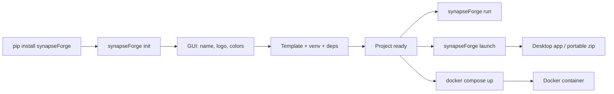

<p align="center">
  
</p>

---

<h1 align="center">
  
</h1>

---

<p align="center">
  <a href="./LICENSE">
    
  </a>
  &nbsp;
  <a href="https://link.mercadopago.com.ar/synapseforge">
    
  </a>
</p>

---

<h3 align="center">Forge agents. Ship intelligence.</h3>

---

<p align="center">
  An open-source forge for creating, equipping, running and shipping autonomous AI agents.

---

<p align="center">
  <sub>CLI · Agent Factory · Distribution</sub>
</p>
</p>

---

```
    FORGE             EQUIP             RUN              SHIP
    ─────             ─────             ───              ────
    Agents            Permissions       AgentLoop        Docker
    Skills            Providers         Tool calling     Desktop app
    Tools             Models            RAG search       Portable zip
    Knowledge                           Memory           Ready to ship
                                        Streaming SSE
```

---

## What is synapseForge?

Most AI agent tools give you pieces and rules. synapseForge gives you the forge.

You don't assemble an agent. You forge a system.

synapseForge is designed around a simple idea: agents should be built as systems, not assembled from prompts.

Define your agents, equip them with skills and tools, connect them to your data sources, and ship a self-contained application — from `pip install` to a distributable build (Docker, desktop app or portable zip).

### A forge that can extend itself

Create agents, skills, tools and workflows through an LLM-assisted interview. synapseForge doesn't just run agents — it can create the capabilities they need.

---

## How it works

### You build

- **Agents** — define roles, permissions and behavior in `.md` files
- **Skills** — structured knowledge packages with references and frontmatter
- **Tools** — native (filesystem, web, shell, email) or external `.py` files
- **RAG collections** — upload files and web pages, indexed with vector embeddings
- **Workflows** — deterministic DAGs of agent, tool, RAG and shell nodes defined in YAML

### The Forge

The Forge turns those definitions into autonomous systems.

- **Permission engine** — deny-by-default, per-agent, with wildcards and groups
- **Security** — rules against prompt injection, data leaks and dangerous commands or SQL; they go in the router prompt or, with the decision model enabled, the decision model enforces them as a guardrail on the user message
- **Agent loop** — iterative reasoning → tool calling → execution → continuation, with streaming SSE
- **Workflows** — deterministic DAG execution started with a play button: sequential steps, same-step nodes in parallel, background runs with retries, persisted results and notifications
- **Memory** — persistent conversation indexing and cross-session retrieval
- **Multi-provider LLM** — Ollama (local), curated cloud providers (OpenAI-compatible + Google)
- **MCP integration** — connect external tool servers via the Model Context Protocol (stdio, HTTP or SSE), with an on/off switch per server
- **Scheduler** — workflows with a `schedule` block run on a schedule, notify via UI and Telegram

### You ship

```bash
synapseForge init my-project      # scaffold with GUI
synapseForge run .                # develop locally
synapseForge launch -n my-app     # build a desktop app / portable zip
docker compose up --build -d      # or deploy with Docker
```

The result is a self-contained application distribution. Choose the modality that fits: a **Docker** container (autocontained or backend-only), a **desktop app** (embedded Python + native launcher), or a **portable zip** ready to hand to anyone.

---

## Quick start

> Currently available on [PyPI](https://pypi.org/project/synapseForge/).

```bash
pip install synapseForge

# Create a project (interactive GUI)
synapseForge init my-project
cd my-project

# Start in development mode
synapseForge run .
```

On first launch, configure an API key from any curated cloud provider (all offer free tiers) and press **Apply**. Ollama is optional. The knowledge base requires a Google key, and voice notes require a Groq key.

---

## CLI

| Command | What it does |
|---------|-------------|
| `synapseForge init [dir]` | Create a project with interactive GUI |
| `synapseForge launch -p <path> -n <name>` | Build a desktop app / portable distribution zip |
| `synapseForge colors [dir]` | Edit project colors live |
| `synapseForge run [dir]` | Start development servers |
| `synapseForge update [dir]` | Update project to latest template (preserves data) |



---

## Architecture

### Backend

FastAPI application with REST/SSE routers. The agent framework lives in `backend/agent/`: AgentLoop with native tool calling, tools registry (native + external + MCP), SQLite sessions, per-agent permissions, skills, RAG (ChromaDB) and long-term memory.

**Native tools**: `read`, `write`, `edit`, `glob`, `grep`, `list_dir`, `webfetch`, `websearch`, `shell`, `task` (sub-agent delegation), `skill`, `reference`, `rag`, `search_memory`, `check_email`, `send_email`, `query_model_capabilities`.

### Workflows

Deterministic flows defined as flat YAML files (`~/.config/synapseForge/workflows/<name>.yaml`, one file per workflow). Each workflow is a list of nodes with `id`, `type` (`agent`, `tool`, `rag` or `run`), `step` (integer from 1) and exactly one node with `final: true`. Nodes in the same step run in parallel with a barrier; different steps run sequentially. Agent nodes run in memory, without a session, with that agent's own prompt, permissions and parameters; `run` nodes execute shell commands GitHub-Actions style.

A workflow runs from the **play** button of its card in the agent info panel. It runs in the background, in parallel with the chat, and never opens a session nor writes in `messages`; while it runs the card shows "Ejecutando…" and can be cancelled. Before running, the backend verifies that every referenced agent, tool and collection exists — if something is missing, it says what instead of executing. Workflows run under least-privilege permissions derived from their own nodes. Every node is committed with its full result: if a node fails or the app stops, the run is retried (3 attempts in total, exponential backoff) from the first node without a confirmed result. When every node completes, a judge (the decision model, or the chat model if it is not enabled) checks the result; a definitive failure is explained in plain language. The result arrives as a persisted notification in the header bell, with the unread count; the run, every node (with the tokens, cost and time of its LLM calls and the tools an agent node called), the node commits and the calls of the judge are stored in their own tables (`workflow_runs` and `workflow_run_steps`). Only "Revisar con el agente" opens a session, a new one with the result. A dedicated creator (interview + validation + user approval) generates the YAML; the prompt of each `agent` node lives in a toml file in `workflows/prompts/`.

### Checkpoints and decision model

Every tool call the agent dispatches is recorded in SQLite before it runs and confirmed when its result commits. If a flow is cut (cancellation, crash), the next turn starts with the unconfirmed work injected as context, so the agent resumes instead of repeating what was already done. The record is deleted only when the step closes with a validated final answer.

An optional **decision model** (System One) can be enabled in **Config**, independent of the chat model. It returns typed answers with a confidence level instead of text, and makes three checks: whether the user message tries to violate the security rules (guardrail: it is blocked before the chat model runs), whether a final answer really closes the step, and whether a new user message continues the pending work or asks for something else (in which case the pending work is discarded). Models come from the models.dev decision catalog, synced at most once every 24 hours, and the provider's API key must be saved. With the decision model disabled, there is no guardrail check (the security rules go in the router prompt), the agent accepts its own final answer and always keeps the pending work, with no extra calls.

### Frontend

React/Vite/TypeScript SPA with Tailwind v4 and shadcn/ui. Multi-page: chat, skill, tool, agent and workflow creation, RAG management, docs. SSE streaming, tool call visualization, context window gauge, scheduled tasks, usage and billing, metrics dashboard, Telegram toggle.

### Providers

| Provider | Type | Notes |
|----------|------|-------|
| Ollama | Local | Optional, requires local install; listed only while running |
| Google | Cloud | Gemini models + RAG embeddings; free tier |
| OpenAI-compatible | Cloud | Groq, OpenRouter, OpenAI, DeepSeek, xAI, Together AI, Fireworks AI, Cerebras, Mistral AI, Perplexity, Meta, Moonshot AI, Zhipu AI, Alibaba; free tiers |

Cloud providers are curated in-app: each API key is validated live against its own API and stored encrypted (Fernet) in SQLite, and a provider is listed only while its key is saved. No environment variables needed. Models come from the models.dev catalog cached in SQLite — select provider + model explicitly and press **Apply**.

### Knowledge base (RAG)

ChromaDB with Gemini embeddings (`gemini-embedding-2`) via the Google provider. Upload files and web pages — content is extracted, chunked and indexed for semantic retrieval. Chunking (chunk size and overlap, in characters) is configurable per upload from the UI (defaults: chunk 500, overlap 60). Requires a Google API key: without it, the knowledge base stays disabled and everything else runs normally. Long-term memory: every conversation turn is automatically indexed and searchable across sessions via `search_memory`.

### Telegram

Remote control for the agent. Send messages, switch models, create skills/tools, manage scheduled tasks — all through Telegram. The bot bridges to the same chat flow the frontend uses.

### Scheduled tasks

A scheduled task is a workflow whose YAML has a `schedule` block (time `HH:MM` + weekdays). Tasks are created with the workflow creator — from the header Agenda (name, description, schedules and the resources the workflow will use) or with `/agendar` on Telegram — and run in the workflow engine like any run (retries, judge, notifications). The Agenda panel also edits schedules, runs tasks with play, cancels them and deletes them (workflow + runs + notifications). The backend checks every 20 seconds for schedules matching the current minute; the system timezone is used, with no configuration.

### Usage and billing

The header has two buttons: **Usage** and **Billing**, with the current month's data.

**Usage** shows the month's consumption: requests, total tokens, spend in USD and the input/output token breakdown, plus per-provider detail and configured limits.

**Billing** shows the month's spend per provider and model, with provider and model filters. Each model shows input and output tokens with their rate and cost, total cost and request count. It also configures spend limits per provider or model: when a limit is reached, requests are blocked until it is raised.

All cloud model activity is tracked: chat, tools, creators, agenda, embeddings and transcriptions. Local models (Ollama) have no cost and are not counted.

---

## Project structure

```plaintext
synapseForge/
├─ synapseforge/              # CLI + tkinter GUIs
├─ pipeline/                  # init / update / launch pipelines + template.zip
├─ backend/                   # FastAPI + Agent Framework
│  ├─ agent/                  #   Agent, loop, LLM calls, tools, sessions, permissions
│  ├─ routes/                 #   API endpoints, one module per topic
│  └─ telegram/               #   Telegram bot (polling, dispatch, commands)
├─ frontend/                  # React/Vite/TypeScript SPA
├─ config/                    # Project placeholder values (replace.json)
├─ src/                       # Template assets (company logo, project README template)
├─ store/                     # Skills and tools store
├─ .commands/                 # Local dev commands (sync, push, template, test)
├─ on_boarding/               # Contributor guides and Git workflow
├─ tests/                     # Declarative E2E suites (YAML) and unit tests
└─ pyproject.toml             # Package config
```

`pipeline/template.zip` is the project template that `synapseForge init` and `synapseForge update` download. It is regenerated from `backend/` and `frontend/` (without `node_modules`, `__pycache__` or the local database) with the `template` quick command.

---

## User configuration

```plaintext
~/.config/synapseForge/
├─ skills/            # Installed skills
├─ tools/             # Custom tools (.py)
├─ agents/            # Agent definitions (.md)
├─ workflows/         # Deterministic workflows (<name>.yaml)
├─ knowledge/         # RAG collections (ChromaDB)
├─ mcp.json           # MCP servers
└─ .secret_key        # Key that encrypts the stored API keys (generated)
```

---

## Testing

Declarative E2E suite in `tests/e2e/`. YAML scenarios drive the real backend — chat via SSE, direct API calls — asserting on contracts and structure.

```bash
python -m tests.e2e.runner                # all scenarios
python -m tests.e2e.runner --only rag     # filter by name
```

Other suites:

```bash
python -m tests.workflows.runner          # workflow validation and execution (running backend)
python -m tests.checkpoints.runner        # checkpoints against the real agent.db (running backend + LLM)
pytest tests/frontier                     # checkpoint unit tests
pytest tests/prompts                      # Jinja prompts, permission format and security rules
pytest tests/mcp                          # MCP servers over stdio, HTTP and SSE, and the on/off switch
pytest tests/loop                         # early exits of the agent loop
pytest tests/feedback                     # thumbs up / down on answers
python -m tests.decisor.decision_cli      # decision model, manual run
```

---

## Docker

Deploy the app as a container. Two targets are available in `docker-compose.yml`:

- **`app`** — autocontained: builds the frontend and serves it from the backend in a single container.
- **`backend`** — backend only, for separated deployments (e.g. ACI).

```bash
docker compose up --build -d
# App at http://localhost:8000
```

---

## Tech Stack

[](https://www.python.org/)
[](https://fastapi.tiangolo.com/)
[](https://www.sqlite.org/)
[](https://www.trychroma.com/)
[](https://react.dev/)
[](https://www.typescriptlang.org/)
[](https://vite.dev/)
[](https://tailwindcss.com/)
[](https://ui.shadcn.com/)
[](https://nodejs.org/)
[](https://pyinstaller.org/)
[](https://www.docker.com/)
[](https://telegram.org/)
[](https://pypi.org/)
[](https://groq.com/)
[](https://ai.google.dev/)
[](https://openrouter.ai/)
[](https://ollama.com/)

---

## Support this project

synapseForge is free and open source. If you find it useful, consider supporting its development with a [donation via Mercado Pago](https://link.mercadopago.com.ar/synapseforge).

---

## License

This project is licensed under the terms specified in the [LICENSE](./LICENSE) file.

---

Copyright (c) 2026 SYNAPSE AI SAS

---

*The forge is heating up...*
