# Data dictionary

Generated by `generate_schema_docs.py` from the real schema (`ddl_setup`) and the comments of `queries/ddl/*.sql`. Do not edit by hand: change the comments of the DDL and generate it again.

## Tables

| Table | Purpose |
| --- | --- |
| [`sessions`](#sessions) | Chat sessions. |
| [`messages`](#messages) | Every message of every session: what the user wrote, what the model answered, the tool results and the verdicts of the decision model. |
| [`turn_latency`](#turn_latency) | Seconds each turn took from the user message to the final answer. |
| [`config_kv`](#config_kv) | Key/value store of application settings persisted in the database (for example the global advanced-parameter overrides and the last sync of each model catalog). |
| [`providers`](#providers) | Cache of the LLM providers the application offers (google, openrouter, groq, LOCAL, ...). |
| [`provider_api_keys`](#provider_api_keys) | API key of each provider, stored encrypted. |
| [`error_log`](#error_log) | Errors the application caught, with the session and turn that were running. |
| [`context_files`](#context_files) | Files the user loads as global context. |
| [`attachments`](#attachments) | Files the user attaches to a message. |
| [`scheduled_tasks`](#scheduled_tasks) | Tasks the scheduler runs on its own: a prompt an agent executes at a time of the day. |
| [`task_runs`](#task_runs) | One row per execution of a scheduled task. |
| [`model_catalog`](#model_catalog) | Catalog of the models of the configured providers (models.dev): limits, capabilities and prices. |
| [`decision_catalog`](#decision_catalog) | Catalog of the decision models, synced from models.dev (type=decision) for any provider. |
| [`billing`](#billing) | Usage totals per provider and the limits the provider reports. |
| [`spend`](#spend) | Monthly spend per provider and model: every LLM call adds to the row of its month (llm_process and llm_streaming record it, success or failure). |
| [`spend_limits`](#spend_limits) | Monthly spend limit the user sets for a provider (model NULL) or for one of its models. |
| [`external_usage`](#external_usage) | Usage of services other than chat completions, such as the embeddings of a RAG query. |
| [`creators`](#creators) | Everything the creators (agent, skill, tool and workflow) do, in one table laid out like messages. |
| [`step_frontier`](#step_frontier) | Frontier of unsettled work units for the current step. |
| [`message_feedback`](#message_feedback) | Thumbs up / down the user gives to an assistant answer. |
| [`workflows`](#workflows) | Registry of workflows. |
| [`workflow_runs`](#workflow_runs) | Everything a workflow run does, in one table laid out like messages. |
| [`workflow_run_steps`](#workflow_run_steps) | Commits of a workflow run: one row per node execution. |
| [`notifications`](#notifications) | Notifications of finished workflow runs and scheduled-task executions. |

## sessions

Chat sessions. A root session is a conversation shown in the sidebar; a child session (parent_id set) belongs to a sub-agent called with task or to a node of a workflow run. Deleting a session deletes its children and everything that hangs from it.

| Column | Type | Null | Default | Key | Description |
| --- | --- | --- | --- | --- | --- |
| `id` | INTEGER | no |  | PK | internal row id |
| `session_id` | TEXT | no |  | unique | public id of the session (the one the API and the other tables use) |
| `created_at` | TEXT | no |  |  | local time, ISO format |
| `updated_at` | TEXT | no |  |  | local time of the last message; orders the sidebar |
| `metadata` | TEXT | yes |  |  | JSON object with free data of the origin, e.g. {"source": "workflow"} (workflow, scheduler, review) |
| `title` | TEXT | yes |  |  | title shown in the sidebar |
| `parent_id` | TEXT | yes |  | FK → sessions.session_id | session_id of the parent session (NULL for root sessions) |

Relations:
- `parent_id` → `sessions.session_id` (on delete: cascade)
- Referenced by: `sessions.parent_id`, `messages.session_id`, `turn_latency.session_id`, `attachments.session_id`, `task_runs.session_id`, `step_frontier.session_id`, `message_feedback.session_id`, `workflow_runs.parent_session_id`, `workflow_runs.session_id`, `notifications.session_id`

Indexes: `idx_sessions_parent_id` (parent_id)

## messages

Every message of every session: what the user wrote, what the model answered, the tool results and the verdicts of the decision model. One row per message, with the tokens, time and cost of the LLM call that produced it. A turn is one user message and all the steps the agent takes to answer it.

| Column | Type | Null | Default | Key | Description |
| --- | --- | --- | --- | --- | --- |
| `id` | INTEGER | no |  | PK | internal row id; orders the messages |
| `session_id` | TEXT | no |  | FK → sessions.session_id | session the message belongs to |
| `role` | TEXT | no |  |  | system / user / assistant / tool / title / decisor (verdict of the decision model) |
| `content` | TEXT | yes |  |  | text of the message |
| `reasoning` | TEXT | yes |  |  | reasoning of the model, when it produced one |
| `tool_calls` | TEXT | yes |  |  | JSON list of the tool calls the assistant requested |
| `tool_results` | TEXT | yes |  |  | JSON list of the results of those calls |
| `status` | TEXT | yes |  |  | success / error, for assistant messages |
| `message` | TEXT | yes |  |  | plain description of the error when status is error |
| `prompt_tokens` | INTEGER | yes |  |  | input tokens of the LLM call |
| `completion_tokens` | INTEGER | yes |  |  | output tokens of the LLM call |
| `total_tokens` | INTEGER | yes |  |  | prompt_tokens + completion_tokens |
| `total_time` | REAL | yes |  |  | seconds the call took |
| `time_to_first_token` | REAL | yes |  |  | seconds until the first token arrived |
| `tool_call_id` | TEXT | yes |  |  | id of the tool call, in tool messages |
| `tool_name` | TEXT | yes |  |  | name of the tool, in tool messages |
| `model` | TEXT | yes |  |  | model that produced the message |
| `provider` | TEXT | yes |  |  | provider of that model |
| `cost_input` | REAL | yes |  |  | USD cost of the input tokens |
| `cost_output` | REAL | yes |  |  | USD cost of the output tokens |
| `cost_total` | REAL | yes |  |  | cost_input + cost_output |
| `turn_number` | INTEGER | yes |  |  | turn of the session (1, 2, ...) |
| `step` | INTEGER | yes | `0` |  | step inside the turn (one per LLM round) |
| `substep` | INTEGER | yes | `0` |  | position inside the step (parallel tool calls) |
| `created_at` | TEXT | no |  |  | local time, ISO format |

Relations:
- `session_id` → `sessions.session_id` (on delete: cascade)

Indexes: `idx_messages_session_id` (session_id)

## turn_latency

Seconds each turn took from the user message to the final answer.

| Column | Type | Null | Default | Key | Description |
| --- | --- | --- | --- | --- | --- |
| `id` | INTEGER | no |  | PK | internal row id |
| `session_id` | TEXT | no |  | FK → sessions.session_id | session of the turn |
| `turn_number` | INTEGER | no |  |  | turn of the session |
| `latency` | REAL | yes |  |  | seconds of the whole turn |

Relations:
- `session_id` → `sessions.session_id` (on delete: cascade)

Indexes: `idx_turn_latency_session_turn` (session_id, turn_number)

## config_kv

Key/value store of application settings persisted in the database (for example the global advanced-parameter overrides and the last sync of each model catalog).

| Column | Type | Null | Default | Key | Description |
| --- | --- | --- | --- | --- | --- |
| `key` | TEXT | no |  | PK | name of the setting |
| `value` | TEXT | yes |  |  | value of the setting, as text |

## providers

Cache of the LLM providers the application offers (google, openrouter, groq, LOCAL, ...). Rows are upserted, never deleted. Most tables that hold a provider name point here.

| Column | Type | Null | Default | Key | Description |
| --- | --- | --- | --- | --- | --- |
| `provider` | TEXT | no |  | PK | provider id, e.g. google |
| `label` | TEXT | no |  |  | name shown to the user |
| `models` | TEXT | yes |  |  | JSON list of the model ids the provider offers |
| `updated_at` | TEXT | no |  |  | local time of the last refresh |

Relations:
- Referenced by: `provider_api_keys.provider`, `model_catalog.provider`, `billing.provider`, `spend.provider`, `spend_limits.provider`

## provider_api_keys

API key of each provider, stored encrypted. One row per provider.

| Column | Type | Null | Default | Key | Description |
| --- | --- | --- | --- | --- | --- |
| `provider` | TEXT | no |  | PK, FK → providers.provider | provider the key belongs to |
| `api_key_encrypted` | TEXT | no |  |  | encrypted API key |
| `updated_at` | TEXT | no |  |  | local time the key was saved |

Relations:
- `provider` → `providers.provider` (on delete: no action)

## error_log

Errors the application caught, with the session and turn that were running. It has no foreign key on purpose: an error must be stored even when its session does not exist (anymore) and it must outlive the session.

| Column | Type | Null | Default | Key | Description |
| --- | --- | --- | --- | --- | --- |
| `id` | INTEGER | no |  | PK | internal row id |
| `session_id` | TEXT | yes |  |  | session that was running, when there was one |
| `parent_id` | TEXT | yes |  |  | parent session of that session |
| `turn_number` | INTEGER | yes |  |  | turn that was running |
| `exception` | TEXT | no |  |  | error message |
| `source` | TEXT | yes |  |  | where it was caught (file:function) |
| `created_at` | TEXT | no |  |  | local time, ISO format |

Indexes: `idx_error_log_created_at` (created_at), `idx_error_log_session_id` (session_id)

## context_files

Files the user loads as global context. Their content is added to the system prompt of every conversation.

| Column | Type | Null | Default | Key | Description |
| --- | --- | --- | --- | --- | --- |
| `id` | INTEGER | no |  | PK | internal row id |
| `filename` | TEXT | no |  |  | original file name |
| `content` | TEXT | no |  |  | text of the file |
| `created_at` | TEXT | no |  |  | local time the file was loaded |

## attachments

Files the user attaches to a message. Deleted with the session.

| Column | Type | Null | Default | Key | Description |
| --- | --- | --- | --- | --- | --- |
| `id` | INTEGER | no |  | PK | internal row id |
| `session_id` | TEXT | no |  | FK → sessions.session_id | session of the message |
| `turn_number` | INTEGER | no |  |  | turn the file was attached to |
| `file_name` | TEXT | no |  |  | original file name |
| `size` | INTEGER | yes |  |  | size in bytes |
| `content` | BLOB | yes |  |  | bytes of the file |
| `created_at` | TEXT | no |  |  | local time, ISO format |

Relations:
- `session_id` → `sessions.session_id` (on delete: cascade)

Indexes: `idx_attachments_session_turn` (session_id, turn_number)

## scheduled_tasks

Tasks the scheduler runs on its own: a prompt an agent executes at a time of the day.

| Column | Type | Null | Default | Key | Description |
| --- | --- | --- | --- | --- | --- |
| `id` | TEXT | no |  | PK | task id |
| `name` | TEXT | no |  |  | name shown to the user |
| `prompt` | TEXT | no |  |  | what the agent has to do |
| `time` | TEXT | no | `'09:00'` |  | main time of the day, HH:MM |
| `days` | TEXT | no | `'[0,1,2,3,4,5,6]'` |  | JSON list of the weekdays it runs (0 = Sunday, 1 = Monday, ...) |
| `enabled` | INTEGER | no | `1` |  | 1 active, 0 paused |
| `repetitions` | TEXT | yes |  |  | JSON list of extra slots [{"time": "HH:MM", "days": [0..6]}] |
| `tool_permissions` | TEXT | yes |  |  | JSON with the tools the run may use |
| `skill_permissions` | TEXT | yes |  |  | JSON with the skills the run may use |
| `parameters` | TEXT | yes |  |  | JSON with the model parameters of the run |
| `last_run_date` | TEXT | yes |  |  | date of the last execution of the main slot |
| `slot_runs` | TEXT | yes |  |  | JSON map slot -> date of its last execution |
| `created_at` | TEXT | no |  |  | local time, ISO format |
| `updated_at` | TEXT | no |  |  | local time of the last edit |

Relations:
- Referenced by: `task_runs.task_id`, `notifications.task_id`

## task_runs

One row per execution of a scheduled task. The session of the run is kept as long as it exists; if it is deleted the run stays without session.

| Column | Type | Null | Default | Key | Description |
| --- | --- | --- | --- | --- | --- |
| `id` | INTEGER | no |  | PK | internal row id; also the run_id of its notification |
| `task_id` | TEXT | no |  | FK → scheduled_tasks.id | task that ran |
| `session_id` | TEXT | yes |  | FK → sessions.session_id | session where the agent worked |
| `status` | TEXT | no |  |  | success / error |
| `detail` | TEXT | yes |  |  | first characters of the answer, or the failure reason |
| `started_at` | TEXT | no |  |  | local time the run started |
| `finished_at` | TEXT | yes |  |  | local time the run ended |

Relations:
- `session_id` → `sessions.session_id` (on delete: set null)
- `task_id` → `scheduled_tasks.id` (on delete: cascade)

Indexes: `idx_task_runs_started_at` (started_at), `idx_task_runs_task_id` (task_id)

## model_catalog

Catalog of the models of the configured providers (models.dev): limits, capabilities and prices. calculate_cost reads the prices from here.

| Column | Type | Null | Default | Key | Description |
| --- | --- | --- | --- | --- | --- |
| `provider` | TEXT | no |  | PK (composite), FK → providers.provider | provider that serves the model |
| `model_id` | TEXT | no |  | PK (composite) | id of the model for that provider |
| `type` | TEXT | yes |  |  | kind of model (chat, embedding, ...) |
| `name` | TEXT | yes |  |  | name shown to the user |
| `description` | TEXT | yes |  |  | short description |
| `family` | TEXT | yes |  |  | family of the model |
| `context_window` | INTEGER | yes |  |  | tokens of context the model accepts |
| `input_limit` | INTEGER | yes |  |  | maximum input tokens |
| `output_limit` | INTEGER | yes |  |  | maximum output tokens |
| `reasoning` | INTEGER | yes | `0` |  | 1 if the model reasons |
| `reasoning_options` | TEXT | yes |  |  | JSON with the reasoning levels it accepts |
| `tool_call` | INTEGER | yes | `0` |  | 1 if it supports tool calling |
| `attachment` | INTEGER | yes | `0` |  | 1 if it accepts attachments |
| `temperature` | INTEGER | yes | `0` |  | 1 if the temperature can be set |
| `structured_output` | INTEGER | yes | `0` |  | 1 if it supports structured output |
| `modalities_input` | TEXT | yes |  |  | JSON list of the input modalities (text, image, ...) |
| `modalities_output` | TEXT | yes |  |  | JSON list of the output modalities |
| `cost_input` | REAL | yes |  |  | USD per million input tokens |
| `cost_output` | REAL | yes |  |  | USD per million output tokens |
| `cost_cache_read` | REAL | yes |  |  | USD per million cached input tokens read |
| `cost_cache_write` | REAL | yes |  |  | USD per million cached input tokens written |
| `open_weights` | INTEGER | yes | `0` |  | 1 if the weights are open |
| `status` | TEXT | yes |  |  | lifecycle status of the model (beta, deprecated, ...) |
| `api` | TEXT | yes |  |  | API base URL of the provider |
| `npm` | TEXT | yes |  |  | SDK package the provider documents |
| `updated_at` | TEXT | no |  |  | local time of the last refresh |

Relations:
- `provider` → `providers.provider` (on delete: no action)

Indexes: `idx_model_catalog_context` (context_window), `idx_model_catalog_reasoning` (reasoning), `idx_model_catalog_model` (model_id), `idx_model_catalog_provider` (provider)

## decision_catalog

Catalog of the decision models, synced from models.dev (type=decision) for any provider. It has the same columns as model_catalog; its providers are not necessarily configured, so it has no foreign key to providers. calculate_cost falls back to it when a model is not in model_catalog.

| Column | Type | Null | Default | Key | Description |
| --- | --- | --- | --- | --- | --- |
| `provider` | TEXT | no |  | PK (composite) | provider that serves the model |
| `model_id` | TEXT | no |  | PK (composite) | id of the model for that provider |
| `type` | TEXT | yes |  |  | kind of model (chat, embedding, ...) |
| `name` | TEXT | yes |  |  | name shown to the user |
| `description` | TEXT | yes |  |  | short description |
| `family` | TEXT | yes |  |  | family of the model |
| `context_window` | INTEGER | yes |  |  | tokens of context the model accepts |
| `input_limit` | INTEGER | yes |  |  | maximum input tokens |
| `output_limit` | INTEGER | yes |  |  | maximum output tokens |
| `reasoning` | INTEGER | yes | `0` |  | 1 if the model reasons |
| `reasoning_options` | TEXT | yes |  |  | JSON with the reasoning levels it accepts |
| `tool_call` | INTEGER | yes | `0` |  | 1 if it supports tool calling |
| `attachment` | INTEGER | yes | `0` |  | 1 if it accepts attachments |
| `temperature` | INTEGER | yes | `0` |  | 1 if the temperature can be set |
| `structured_output` | INTEGER | yes | `0` |  | 1 if it supports structured output |
| `modalities_input` | TEXT | yes |  |  | JSON list of the input modalities (text, image, ...) |
| `modalities_output` | TEXT | yes |  |  | JSON list of the output modalities |
| `cost_input` | REAL | yes |  |  | USD per million input tokens |
| `cost_output` | REAL | yes |  |  | USD per million output tokens |
| `cost_cache_read` | REAL | yes |  |  | USD per million cached input tokens read |
| `cost_cache_write` | REAL | yes |  |  | USD per million cached input tokens written |
| `open_weights` | INTEGER | yes | `0` |  | 1 if the weights are open |
| `status` | TEXT | yes |  |  | lifecycle status of the model (beta, deprecated, ...) |
| `api` | TEXT | yes |  |  | API base URL of the provider |
| `npm` | TEXT | yes |  |  | SDK package the provider documents |
| `updated_at` | TEXT | no |  |  | local time of the last refresh |

Indexes: `idx_decision_catalog_type` (type), `idx_decision_catalog_model` (model_id), `idx_decision_catalog_provider` (provider)

## billing

Usage totals per provider and the limits the provider reports. The current code does not write it: the billing statistics are computed from spend.

| Column | Type | Null | Default | Key | Description |
| --- | --- | --- | --- | --- | --- |
| `id` | INTEGER | no |  | PK | internal row id |
| `provider` | TEXT | no |  | FK → providers.provider, unique | provider the totals belong to |
| `requests` | INTEGER | yes | `0` |  | number of LLM calls |
| `prompt_tokens` | INTEGER | yes | `0` |  | input tokens |
| `completion_tokens` | INTEGER | yes | `0` |  | output tokens |
| `total_tokens` | INTEGER | yes | `0` |  | input + output tokens |
| `cost` | REAL | yes | `0.0` |  | USD spent |
| `provider_limits` | TEXT | yes |  |  | JSON with the limits the provider reports |
| `created_at` | TEXT | no |  |  | local time, ISO format |
| `updated_at` | TEXT | no |  |  | local time of the last update |

Relations:
- `provider` → `providers.provider` (on delete: no action)

Indexes: `idx_billing_provider` (provider)

## spend

Monthly spend per provider and model: every LLM call adds to the row of its month (llm_process and llm_streaming record it, success or failure).

| Column | Type | Null | Default | Key | Description |
| --- | --- | --- | --- | --- | --- |
| `id` | INTEGER | no |  | PK | internal row id |
| `provider` | TEXT | no |  | FK → providers.provider | provider of the calls |
| `model` | TEXT | no |  |  | model of the calls |
| `month` | TEXT | no |  |  | month of the calls, YYYY-MM |
| `requests` | INTEGER | yes | `0` |  | number of calls |
| `prompt_tokens` | INTEGER | yes | `0` |  | input tokens |
| `completion_tokens` | INTEGER | yes | `0` |  | output tokens |
| `total_tokens` | INTEGER | yes | `0` |  | input + output tokens |
| `cost_input` | REAL | yes | `0.0` |  | USD cost of the input tokens |
| `cost_output` | REAL | yes | `0.0` |  | USD cost of the output tokens |
| `cost_total` | REAL | yes | `0.0` |  | cost_input + cost_output |
| `updated_at` | TEXT | no |  |  | local time of the last call added |

Relations:
- `provider` → `providers.provider` (on delete: no action)

Indexes: `idx_spend_provider_model` (provider, model, month)

## spend_limits

Monthly spend limit the user sets for a provider (model NULL) or for one of its models.

| Column | Type | Null | Default | Key | Description |
| --- | --- | --- | --- | --- | --- |
| `id` | INTEGER | no |  | PK | internal row id |
| `provider` | TEXT | no |  | FK → providers.provider | provider the limit applies to |
| `model` | TEXT | yes |  |  | model the limit applies to; NULL means the whole provider |
| `limit_amount` | REAL | no |  |  | monthly limit in USD |
| `created_at` | TEXT | no |  |  | local time, ISO format |
| `updated_at` | TEXT | no |  |  | local time of the last edit |

Relations:
- `provider` → `providers.provider` (on delete: no action)

Indexes: `idx_spend_limits_provider_model` (provider, model)

## external_usage

Usage of services other than chat completions, such as the embeddings of a RAG query. The provider column is free text (it can be unknown), so it has no foreign key.

| Column | Type | Null | Default | Key | Description |
| --- | --- | --- | --- | --- | --- |
| `id` | INTEGER | no |  | PK | internal row id |
| `kind` | TEXT | no |  |  | kind of service, e.g. embedding |
| `provider` | TEXT | no |  |  | provider of the service |
| `model` | TEXT | no |  |  | model used |
| `units` | INTEGER | yes | `0` |  | number of calls |
| `prompt_tokens` | INTEGER | yes | `0` |  | input tokens |
| `completion_tokens` | INTEGER | yes | `0` |  | output tokens |
| `duration` | REAL | yes |  |  | seconds the call took |
| `session_id` | TEXT | yes |  |  | session that made the call, when there was one |
| `turn_number` | INTEGER | yes |  |  | turn of that session |
| `step` | INTEGER | yes |  |  | step of that turn |
| `created_at` | TEXT | no |  |  | local time, ISO format |

Indexes: `idx_external_usage_kind` (kind)

## creators

Everything the creators (agent, skill, tool and workflow) do, in one table laid out like messages. One creator conversation (creator_id) is a chain of rows: user: what the user wrote in a request (the first one carries setup, the JSON of the form). assistant: text and reasoning the creator streamed. tool: a tool call of the creator with its arguments (tool_calls) and result (tool_results). result: how the request ended (action, item_name, status, message, seconds in total_time). call: one LLM call with its tokens and cost. Calls of the evaluators and the agenda prompt crafter have no conversation (creator_id NULL). spend is not touched here: llm_process already records it. The usage of a request lives in its call rows. The conversations of a creator are listed in its history sidebar and can be reopened to keep modifying what was created. creator_id has no foreign key: no table holds the conversations, they are the group of rows that share it. The provider is free text (it can be unknown).

| Column | Type | Null | Default | Key | Description |
| --- | --- | --- | --- | --- | --- |
| `id` | INTEGER | no |  | PK | internal row id; orders the rows |
| `creator_id` | TEXT | yes |  |  | conversation the row belongs to (NULL for calls outside a conversation) |
| `kind` | TEXT | no |  |  | agent / skill / tool / workflow / other |
| `role` | TEXT | no |  |  | user / assistant / tool / result / call |
| `content` | TEXT | yes |  |  | text of a user or assistant row |
| `reasoning` | TEXT | yes |  |  | reasoning streamed by the creator |
| `tool_calls` | TEXT | yes |  |  | JSON with the arguments of the tool call (tool rows) |
| `tool_results` | TEXT | yes |  |  | JSON with the result of the tool call (tool rows) |
| `tool_name` | TEXT | yes |  |  | tool the creator called (tool rows) |
| `status` | TEXT | yes |  |  | success / error / aborted (result rows) |
| `message` | TEXT | yes |  |  | result or failure message shown to the user (result rows) |
| `caller` | TEXT | yes |  |  | who made the LLM call, e.g. creator:skill:generate (call rows) |
| `action` | TEXT | yes |  |  | question / create / iterate / exists (result rows) |
| `item_name` | TEXT | yes |  |  | name of the item created or modified (result rows) |
| `setup` | TEXT | yes |  |  | JSON with the form of the request: description, name, parameters, ... (first user row) |
| `provider` | TEXT | yes |  |  | provider used |
| `model` | TEXT | yes |  |  | model used |
| `prompt_tokens` | INTEGER | yes | `0` |  | input tokens (call rows) |
| `completion_tokens` | INTEGER | yes | `0` |  | output tokens (call rows) |
| `total_tokens` | INTEGER | yes | `0` |  | input + output tokens (call rows) |
| `total_time` | REAL | yes |  |  | seconds the call or the request took |
| `cost_input` | REAL | yes | `0.0` |  | USD cost of the input tokens |
| `cost_output` | REAL | yes | `0.0` |  | USD cost of the output tokens |
| `cost_total` | REAL | yes | `0.0` |  | cost_input + cost_output |
| `created_at` | TEXT | no |  |  | local time, ISO format |

Indexes: `idx_creators_caller` (caller), `idx_creators_kind_created_at` (kind, created_at), `idx_creators_creator_id` (creator_id)

## step_frontier

Frontier of unsettled work units for the current step. One row per dispatched tool call, written at dispatch time (state 'open') and flipped to 'done' when its result commits. Rows are only deleted when the step closes with a validated done signal; a cut flow leaves them behind so the next turn can resume from them.

| Column | Type | Null | Default | Key | Description |
| --- | --- | --- | --- | --- | --- |
| `id` | INTEGER | no |  | PK | internal row id |
| `session_id` | TEXT | no |  | FK → sessions.session_id | session of the turn |
| `turn_number` | INTEGER | no |  |  | turn the call belongs to |
| `step` | INTEGER | no | `0` |  | step of the turn |
| `substep` | INTEGER | no | `0` |  | position inside the step |
| `tool_call_id` | TEXT | yes |  |  | id of the tool call |
| `tool_name` | TEXT | no |  |  | tool that was called |
| `tool_args` | TEXT | yes |  |  | JSON with the arguments of the call |
| `state` | TEXT | no | `'open'` |  | open (dispatched) / done (result committed) |
| `child_id` | TEXT | yes |  |  | session_id of the sub-agent, when the call was a task |
| `created_at` | TEXT | no |  |  | local time the call was dispatched |
| `updated_at` | TEXT | no |  |  | local time of the last change |

Relations:
- `session_id` → `sessions.session_id` (on delete: cascade)

Indexes: `idx_step_frontier_session_turn` (session_id, turn_number)

## message_feedback

Thumbs up / down the user gives to an assistant answer. One row per answer (a turn of a session); clicking again removes it. model and provider are the ones that produced the answer, so feedback can later be read per model.

| Column | Type | Null | Default | Key | Description |
| --- | --- | --- | --- | --- | --- |
| `id` | INTEGER | no |  | PK | internal row id |
| `session_id` | TEXT | no |  | FK → sessions.session_id | session of the answer |
| `turn_number` | INTEGER | no |  |  | turn of the answer |
| `feedback_type` | TEXT | no |  |  | up / down |
| `model` | TEXT | yes |  |  | model that produced the answer |
| `provider` | TEXT | yes |  |  | provider of that model |
| `created_at` | TEXT | no |  |  | local time the feedback was given |
| `updated_at` | TEXT | no |  |  | local time of the last change |

Relations:
- `session_id` → `sessions.session_id` (on delete: cascade)

Indexes: `idx_message_feedback_created_at` (created_at)

## workflows

Registry of workflows. The YAML file stays the definition; the name is the id. A row is created the first time a workflow is saved or run.

| Column | Type | Null | Default | Key | Description |
| --- | --- | --- | --- | --- | --- |
| `name` | TEXT | no |  | PK | workflow name; also the name of its YAML file |
| `created_at` | TEXT | no |  |  | local time the workflow was registered |
| `updated_at` | TEXT | no |  |  | local time of the last change |

Relations:
- Referenced by: `workflow_runs.workflow_name`, `notifications.workflow_name`

## workflow_runs

Everything a workflow run does, in one table laid out like messages. A run is the group of rows that share run_id (also the id of its session), and kind says what each row is: run: the execution itself (source, status, attempt, started_at, finished_at, result, error_text and its sessions). It is the only row of the run that has a result and a source. node: one execution of a node (step, substep, node_id, node_type, status, result or error_text, child_session_id). The nodes of a step run in parallel, each with its own substep. An agent node adds up the spend of its child session. decision: verdict of the decision model on the run. status: approved | rejected; result holds the JSON of its answers. judge: verdict of the chat LLM, used when the decision model is not ready. status: approved | rejected | error; result holds the text it answered. output: the LLM call that writes the output of the run (status: success | error). explain: the LLM call that explains in plain language why a run failed (status: success | error). Rows of a run are never deleted when it ends (workflow_run_steps, in contrast, only keeps what is needed to resume a run and is cleaned when it ends well). The spend of a run is the sum of its rows. spend is NOT touched here: llm_process already records it. status of a run row: running | success | error | cancelled. source: play (UI button) | tool (called by an agent through the workflow tool). attempt: attempt that made the row, 1..3. step / substep: step of the workflow and position inside it (node rows); the rows of the engine take the next step of the run, with substep 0. The sessions are kept while they exist; if one is deleted the row stays without it. run_id has no foreign key: it is the group of rows that share it, so no column is unique to reference.

| Column | Type | Null | Default | Key | Description |
| --- | --- | --- | --- | --- | --- |
| `id` | INTEGER | no |  | PK | internal row id; orders the rows |
| `run_id` | TEXT | no |  |  | run the row belongs to; also the id of its session |
| `workflow_name` | TEXT | no |  | FK → workflows.name | workflow that ran |
| `kind` | TEXT | no |  |  | run / node / decision / judge / output / explain |
| `attempt` | INTEGER | no | `1` |  | attempt that made the row, 1..3 |
| `step` | INTEGER | no | `0` |  | step of the workflow (0 in the run row) |
| `substep` | INTEGER | no | `0` |  | position of the row inside its step |
| `node_id` | TEXT | yes |  |  | id of the node in the YAML (node rows) |
| `node_type` | TEXT | yes |  |  | agent / tool / rag / run (node rows) |
| `status` | TEXT | yes |  |  | run: running / success / error / cancelled; node: success / error / cancelled; decision, judge: approved / rejected / error; output, explain: success / error |
| `source` | TEXT | yes |  |  | play / tool (run row) |
| `session_id` | TEXT | yes |  | FK → sessions.session_id | session that holds the execution (run row) |
| `parent_session_id` | TEXT | yes |  | FK → sessions.session_id | session of the agent that called the workflow (run row, source tool) |
| `child_session_id` | TEXT | yes |  |  | session of the sub-agent (agent node rows) |
| `result` | TEXT | yes |  |  | output of the run, of the node or of the call |
| `error_text` | TEXT | yes |  |  | failure message of a node, or plain-language explanation of a failed run |
| `provider` | TEXT | yes |  |  | provider of the model that produced the row |
| `model` | TEXT | yes |  |  | model that produced the row |
| `prompt_tokens` | INTEGER | no | `0` |  | input tokens |
| `completion_tokens` | INTEGER | no | `0` |  | output tokens |
| `total_tokens` | INTEGER | no | `0` |  | prompt_tokens + completion_tokens |
| `total_time` | REAL | no | `0` |  | seconds the LLM calls took |
| `cost_input` | REAL | no | `0` |  | USD cost of the input tokens |
| `cost_output` | REAL | no | `0` |  | USD cost of the output tokens |
| `cost_total` | REAL | no | `0` |  | cost_input + cost_output |
| `started_at` | TEXT | no |  |  | local time the row started |
| `finished_at` | TEXT | yes |  |  | local time the row ended |

Relations:
- `parent_session_id` → `sessions.session_id` (on delete: set null)
- `session_id` → `sessions.session_id` (on delete: set null)
- `workflow_name` → `workflows.name` (on delete: no action)

Indexes: `idx_workflow_runs_started_at` (started_at), `idx_workflow_runs_status` (status), `idx_workflow_runs_name` (workflow_name), `idx_workflow_runs_one_run` (run_id, unique), `idx_workflow_runs_run` (run_id, kind)

## workflow_run_steps

Commits of a workflow run: one row per node execution. state: open (dispatched) | done (result committed) | failed | stale (a done row invalidated because an earlier step had to be re-run). result holds the complete node output (never truncated) so a retry or a resume after a crash rebuilds the shared state without re-running it. What ended is deleted: a run that finished well keeps no rows here, only a run that failed or was cut leaves them to resume from. The record of everything the run did lives in workflow_runs. run_id has no foreign key: it is the group of rows of workflow_runs that share it, so no column is unique to reference.

| Column | Type | Null | Default | Key | Description |
| --- | --- | --- | --- | --- | --- |
| `id` | INTEGER | no |  | PK | internal row id |
| `run_id` | TEXT | no |  |  | run the node belongs to (workflow_runs.run_id) |
| `attempt` | INTEGER | no | `1` |  | attempt of the run that executed it |
| `step` | INTEGER | no |  |  | step of the workflow (nodes of the same step run in parallel) |
| `substep` | INTEGER | no | `0` |  | position of the node inside its step |
| `node_id` | TEXT | no |  |  | id of the node in the YAML |
| `node_type` | TEXT | no |  |  | agent / tool / rag / run |
| `args` | TEXT | yes |  |  | JSON with the arguments of the node |
| `state` | TEXT | no | `'open'` |  | open / done / failed / stale |
| `result` | TEXT | yes |  |  | complete output of the node |
| `error` | TEXT | yes |  |  | failure message when state is failed |
| `child_session_id` | TEXT | yes |  |  | session of the sub-agent, in agent nodes |
| `created_at` | TEXT | no |  |  | local time the node was dispatched |
| `updated_at` | TEXT | no |  |  | local time of the last change |

Indexes: `idx_workflow_run_steps_run` (run_id, step)

## notifications

Notifications of finished workflow runs and scheduled-task executions. Exactly one of workflow_name / task_id is set (FK to the PK of each table). run_id: workflow_runs.run_id or task_runs.id (as text) to open the detail; it has no foreign key because it points to one table or the other depending on kind. status: success | error. read: 0 unread, 1 read.

| Column | Type | Null | Default | Key | Description |
| --- | --- | --- | --- | --- | --- |
| `id` | INTEGER | no |  | PK | internal row id |
| `kind` | TEXT | no |  |  | workflow / task |
| `workflow_name` | TEXT | yes |  | FK → workflows.name | workflow that finished (kind workflow) |
| `task_id` | TEXT | yes |  | FK → scheduled_tasks.id | scheduled task that finished (kind task) |
| `run_id` | TEXT | yes |  |  | id of the run in workflow_runs (run_id) or task_runs (id) |
| `title` | TEXT | no |  |  | workflow or task name shown in the bell |
| `status` | TEXT | no |  |  | success / error |
| `message` | TEXT | yes |  |  | short text of the result or the failure explanation |
| `session_id` | TEXT | yes |  | FK → sessions.session_id | session of the execution, while it exists |
| `read` | INTEGER | no | `0` |  | 0 unread, 1 read |
| `created_at` | TEXT | no |  |  | local time, ISO format |

Relations:
- `session_id` → `sessions.session_id` (on delete: set null)
- `task_id` → `scheduled_tasks.id` (on delete: no action)
- `workflow_name` → `workflows.name` (on delete: no action)

Indexes: `idx_notifications_created_at` (created_at), `idx_notifications_read` (read)

## Entity-relationship diagram

Every table has a primary key. The diagram shows only the key columns (`PK`, `FK`); the columns of each table are in its section above. The same schema in DBML is in `schema.dbml`.

```mermaid
erDiagram
    sessions {
        integer id PK
        text parent_id FK
    }
    messages {
        integer id PK
        text session_id FK
    }
    turn_latency {
        integer id PK
        text session_id FK
    }
    config_kv {
        text key PK
    }
    providers {
        text provider PK
    }
    provider_api_keys {
        text provider PK,FK
    }
    error_log {
        integer id PK
    }
    context_files {
        integer id PK
    }
    attachments {
        integer id PK
        text session_id FK
    }
    scheduled_tasks {
        text id PK
    }
    task_runs {
        integer id PK
        text task_id FK
        text session_id FK
    }
    model_catalog {
        text provider PK,FK
        text model_id PK
    }
    decision_catalog {
        text provider PK
        text model_id PK
    }
    billing {
        integer id PK
        text provider FK
    }
    spend {
        integer id PK
        text provider FK
    }
    spend_limits {
        integer id PK
        text provider FK
    }
    external_usage {
        integer id PK
    }
    creators {
        integer id PK
    }
    step_frontier {
        integer id PK
        text session_id FK
    }
    message_feedback {
        integer id PK
        text session_id FK
    }
    workflows {
        text name PK
    }
    workflow_runs {
        integer id PK
        text workflow_name FK
        text session_id FK
        text parent_session_id FK
    }
    workflow_run_steps {
        integer id PK
    }
    notifications {
        integer id PK
        text workflow_name FK
        text task_id FK
        text session_id FK
    }
    sessions |o--o{ sessions : "parent_id"
    sessions ||--o{ messages : "session_id"
    sessions ||--o{ turn_latency : "session_id"
    providers |o--o{ provider_api_keys : "provider"
    sessions ||--o{ attachments : "session_id"
    sessions |o--o{ task_runs : "session_id"
    scheduled_tasks ||--o{ task_runs : "task_id"
    providers ||--o{ model_catalog : "provider"
    providers ||--o{ billing : "provider"
    providers ||--o{ spend : "provider"
    providers ||--o{ spend_limits : "provider"
    sessions ||--o{ step_frontier : "session_id"
    sessions ||--o{ message_feedback : "session_id"
    sessions |o--o{ workflow_runs : "parent_session_id"
    sessions |o--o{ workflow_runs : "session_id"
    workflows ||--o{ workflow_runs : "workflow_name"
    sessions |o--o{ notifications : "session_id"
    scheduled_tasks |o--o{ notifications : "task_id"
    workflows |o--o{ notifications : "workflow_name"
```

### Tables without foreign keys

These tables have a primary key but no foreign key, and no table references them. It is on purpose:

| Table | Reason |
| --- | --- |
| `config_kv` | Independent key/value settings: no entity to relate to. |
| `error_log` | An error must be stored even when its session does not exist (anymore) and it must outlive the session. With foreign keys enforced, a foreign key on `session_id` would reject it. |
| `context_files` | Global context files: they belong to no session. |
| `decision_catalog` | Its providers are not necessarily configured, so `provider` has no foreign key to `providers`. |
| `external_usage` | The provider is free text (it can be unknown) and the usage is stored even when there is no session, so `provider` and `session_id` have no foreign key. |
| `creators` | No table holds the creator conversations: they are the group of rows that share `creator_id`, so there is nothing for that column to reference. The provider is free text (it can be unknown). |
| `workflow_run_steps` | `run_id` is the group of rows of `workflow_runs` that share it (a run has many rows, so no column is unique to reference). |

### Columns that point to another table without a foreign key

| Column | Holds the id of |
| --- | --- |
| `error_log.session_id` | `sessions.session_id` |
| `error_log.parent_id` | `sessions.session_id` |
| `external_usage.session_id` | `sessions.session_id` |
| `step_frontier.child_id` | `sessions.session_id` |
| `workflow_run_steps.child_session_id` | `sessions.session_id` |
| `notifications.run_id` | `workflow_runs.run_id` or `task_runs.id`, depending on the kind |
| `workflow_run_steps.run_id` | `workflow_runs.run_id` |
