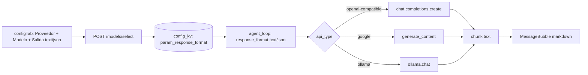

  

---

<h1 align="center">01 — Estado actual del repo (por qué solo sale texto o JSON)</h1>

---

# 01 — Estado actual

**Tipo**: Especificación de Investigación
**Fecha**: 2026-11-14
**Rama**: `feat/outputs`

## Pregunta de investigación

¿Qué parte del sistema limita hoy las salidas a texto o JSON, y qué ya existe para soportar imagen/audio/video?

## Metodología

- **Fuentes primarias**: `backend/agent/llm/completion.py`, `backend/agent/llm/streaming.py`, `backend/agent/loop/agent_loop.py`, `backend/agent/utils/model_catalog.py`, `backend/agent/utils/model_resolver.py`, `backend/agent/utils/provider_keys.py`, `backend/routes/config/models.py`, `backend/routes/config/parameters.py`, `frontend/src/components/configTab.tsx`, `frontend/src/components/CreateModelSelector.tsx`, `frontend/src/services/configService.ts`, `frontend/src/components/MessageBubble.tsx`, `docs/models-dev-api.md`, `requirements.txt`.
- **Criterios**: rastrear el flujo completo proveedor → modelo → parámetro → SDK → streaming → render.
- **Período**: estado de `main` al 2026-11-14 más rama `feat/outputs` recién creada.

## Hallazgos

### Hallazgo 1: el backend solo habla `chat` (texto)

- **Detalle**: `Agent.llm_process` y `Agent.llm_streaming` solo llaman a tres caminos: `client.chat.completions.create` (OpenAI-compatibles), `ollama_client.chat` (LOCAL) y `google_client.aio.models.generate_content` / `generate_content_stream` (Google). Los tres devuelven `content: str` + `tool_calls`. No existe ninguna llamada a `images.generate`, `audio.speech` ni `videos`. Por eso un modelo TTS o de imagen configurado hoy pasa por el camino de chat y falla o devuelve vacío.
- **Fuente**: `backend/agent/llm/completion.py:120-298`, `backend/agent/llm/streaming.py:107-542`.
- **Implicancia**: hay que agregar nuevas familias de llamadas SDK, no alcanza con cambiar parámetros del chat.

### Hallazgo 2: `response_format` solo conoce `text` y `json`

- **Detalle**: el endpoint `POST /api/config/models/select` valida `response_format` contra `("text", "json")` y lo persiste en `config_kv` (`param_response_format`). El loop lo traduce a `response_format={"type": "json_object"}` (OpenAI), `format="json"` (Ollama) o `response_mime_type="application/json"` (Gemini). El frontend (`configTab.tsx` → desplegable "Salida") solo ofrece Default/Texto/JSON y se deshabilita si `response_format_supported` es `false`.
- **Fuente**: `backend/routes/config/models.py:185-203`, `backend/agent/loop/agent_loop.py:325-357`, `frontend/src/components/configTab.tsx:901-921`.
- **Implicancia**: el desplegable pedido por el usuario ("tipo de salida que desee dentro de todas las posibilidades del modelo") debe reemplazar/extender este control, no reutilizarlo tal cual.

### Hallazgo 3: el catálogo ya guarda `modalities_output` pero nadie lo usa para decidir la salida

- **Detalle**: `model_catalog._extract_provider_models` persiste `modalities_input` y `modalities_output` (JSON de `models.dev`) en SQLite (`model_catalog` y `decision_catalog`). `get_reasoning_options` ya los devuelve como `input_modalities` / `output_modalities`, y `GET /api/config/models/capabilities` los expone. El frontend los muestra en "Info del modelo" (Entrada/Salida) pero no filtra ni habilita nada con ellos. Ollama local sintetiza `output_modalities: ["text"]` siempre.
- **Fuente**: `backend/agent/utils/model_catalog.py:182-212,348-406`, `backend/routes/config/models.py:352-416`, `frontend/src/components/configTab.tsx:752-799`.
- **Implicancia**: la fuente de verdad para el desplegable ya existe en la DB; falta la lógica que la convierta en opciones elegibles y en validación.

### Hallazgo 4: streaming y render asumen texto

- **Detalle**: el streaming emite eventos `{'type': 'chunk', 'content': str}`, `reasoning`, `tool_calls_detected`, `usage`, `error`/`aborted`. El frontend (`chatService` + `ChatInterface` + `MessageBubble`) concatena `chunk` como markdown y renderiza con `marked` + `DOMPurify` (+ Mermaid). No hay manejo de `b64_json`, `url` de imagen, bytes de audio ni `video`. Tampoco hay persistencia de binarios (las sesiones guardan mensajes de texto).
- **Fuente**: `backend/agent/llm/streaming.py`, `frontend/src/components/MessageBubble.tsx:1-100`, `frontend/src/services/chatService.ts`.
- **Implicancia**: imagen/audio/video requieren nuevos tipos de eventos SSE, render (``, `<audio>`, `<video>`) y decisión de dónde guardar los bytes (disco/S3/base de datos).

### Hallazgo 5: providers y SDKs instalados

- **Detalle**: `requirements.txt` fija `openai>=1.0.0` (instalado 3.16.2), `google-genai>=1.0.0` (instalado 2.24.0), `ollama>=0.1.0` (instalado 0.6.2). `PROVIDER_REGISTRY` cura 15 providers OpenAI-compatibles + `google` (SDK nativo) + `LOCAL` (Ollama). Todos los OpenAI-compatibles comparten `base_url` y validación `GET {base_url}/models`. La resolución de `api_type` sale del campo `npm` de `models.dev` (`_NPM_TO_API_TYPE`).
- **Fuente**: `requirements.txt:12-16`, `backend/agent/utils/provider_keys.py:43-144`, `backend/agent/utils/model_catalog.py:751-812`.
- **Implicancia**: cualquier endpoint nuevo (imagen/TTS/video) debe resolverse por `api_type` igual que hoy, pero cada provider soporta un subconjunto distinto aunque comparta base OpenAI.

## Diagrama del flujo actual

## Conclusiones

- Hoy no hay bug puntual: el sistema fue diseñado solo para chat de texto.
- El trabajo no es "arreglar TTS", es agregar tres familias nuevas de salidas con sus SDKs, validaciones y render.
- La base (`modalities_output` en DB + endpoint `capabilities`) ya deja el camino a medio hacer.

## Recomendaciones

1. **Corto plazo**: exponer `output_modalities` + `type` en el selector sin cambiar el loop (solo informativo + validación).
2. **Mediano plazo**: implementar imagen y TTS por provider con feature flags.
3. **Largo plazo**: video y persistencia binaria.

## Riesgos y limitaciones

- No se probó en vivo ningún modelo de imagen/TTS contra las keys reales; todo es análisis estático + docs SDK.
- `models.dev` cambia a diario; los conteos de este documento son foto del 2026-11-14.

## Referencias

- `backend/agent/llm/completion.py`, `streaming.py`, `backend/agent/loop/agent_loop.py`
- `backend/agent/utils/model_catalog.py`, `docs/models-dev-api.md`
- `frontend/src/components/configTab.tsx`, `frontend/src/services/configService.ts`

---

Copyright (c) 2026 synapse.ai

---
