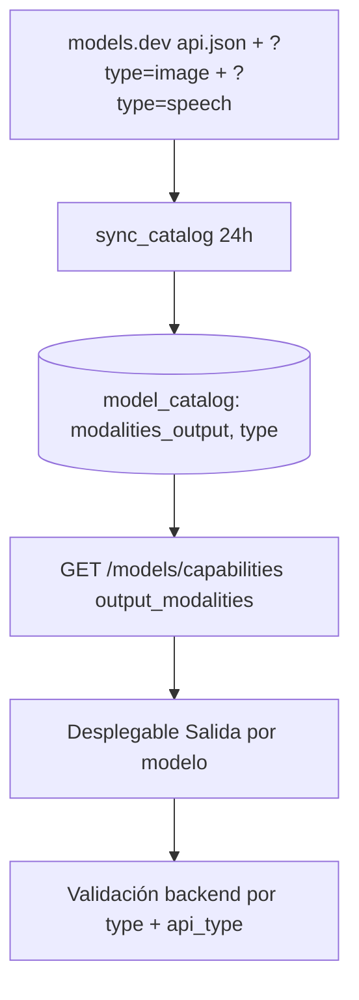

  

---

<h1 align="center">02 — models.dev como fuente de verdad de salidas</h1>

---

# 02 — models.dev como fuente de verdad

**Tipo**: Especificación de Investigación
**Fecha**: 2026-11-14
**Fuentes consultadas**: `https://models.dev/api.json`, `https://models.dev/api.json?type=image`, `https://models.dev/api.json?type=speech`, `docs/models-dev-api.md`

## Pregunta de investigación

¿Qué campo de `models.dev` nos dice qué salidas soporta cada modelo, y qué valores reales existen para los providers que usamos?

## Hallazgos

### Hallazgo 1: `modalities.output` es el campo que debe alimentar el desplegable

- **Detalle**: cada modelo trae `modalities: { input: [...], output: [...] }` con valores `text`, `image`, `audio`, `video`, `pdf` (solo entrada). El backend ya lo guarda como JSON en `model_catalog.modalities_output` y lo expone en `GET /models/capabilities` como `output_modalities`. Es la base del desplegable pedido: "el usuario elige el tipo de salida dentro de todas las posibilidades que ofrece el modelo".
- **Fuente**: `docs/models-dev-api.md:123-138`, `backend/agent/utils/model_catalog.py:201-202`.
- **Implicancia**: no hardcodear opciones; leer `output_modalities` por modelo y mapear a etiquetas (Texto, Imagen, Audio/TTS, Video, JSON).

### Hallazgo 2: `type` distingue la familia de llamada SDK

- **Detalle**: además de `modalities`, cada modelo trae `type` (`chat`, `image`, `speech`, `realtime`, etc.). Ejemplo real: `canopylabs/orpheus-v1-english` tiene `type: "speech"`, `modalities.output: ["audio"]`, `tool_call: false`, `temperature: false`. Los modelos `image` suelen tener `output: ["image"]` o `["image","text"]`. Los `realtime` tienen `["text","audio"]`. El catálogo actual guarda `type` en DB pero `get_reasoning_options` no lo devuelve al frontend.
- **Fuente**: consulta en vivo a `api.json?type=speech` (2026-11-14), `backend/agent/utils/model_catalog.py:187`.
- **Implicancia**: el desplegable necesita `type` + `output_modalities` juntos: `type` decide qué SDK llamar, `modalities` decide qué ofrecer.

### Hallazgo 3: foto real por provider curado (2026-11-14)

- **Detalle**: conteo obtenido por script contra `api.json` en vivo (236 providers totales):
  - `groq` (14 modelos): outputs `audio`, `text`. Ej. `canopylabs/orpheus-*-*` → `["audio"]`, `type: speech`.
  - `openrouter` (378): `audio`, `image`, `text`, `video`. Ej. `openai/gpt-audio` → `["text","audio"]`; `openai/gpt-5.4-image-2` → `["image","text"]`, `type: image`.
  - `openai` (51): `audio`, `image`, `text`. Ej. `gpt-image-1.5/2` → imagen; `gpt-realtime-*` → `["text","audio"]`; `tts-1/tts-1-hd` → `["audio"]`.
  - `xai` (12): `image`, `text`, `video` (familia `grok-imagine-*`).
  - `google` (37): `audio`, `image`, `text`. Ej. `gemini-2.5-flash-preview-tts` → `["audio"]`, `type: speech`; `gemini-3-pro-image` → `["text","image"]`, `type: image`; `gemini-3.5-live-translate-preview` → `["audio","text"]`, `type: realtime`.
  - `mistral` (36): `audio`, `text` (`voxtral-mini-tts-latest` → audio).
  - `alibaba` (53): `audio`, `text` (familia `qwen-omni` → `["text","audio"]`).
  - `deepseek`, `togetherai`, `fireworks-ai`, `cerebras`, `perplexity`, `meta`, `moonshotai`, `zhipuai`: solo `text` (hoy no aportan salidas nuevas).
- **Fuente**: script `requests.get("https://models.dev/api.json")` ejecutado 2026-11-14.
- **Implicancia**: el valor inmediato está en `openai`, `openrouter`, `google`, `groq`, `xai`, `mistral`, `alibaba`. El resto puede mostrar solo Texto/JSON sin romper nada.

### Hallazgo 4: el catálogo por defecto omite tipos especializados

- **Detalle**: `GET /api.json` sin `?type=` omite tipos especializados; hay que pedir `?type=image`, `?type=speech`, etc. por separado. Hoy `model_catalog.sync_catalog` solo llama a `api.json` sin filtro, por lo que los modelos `speech`/`image` puros pueden no estar sincronizados aunque el provider los tenga. La tabla `decision_catalog` ya usa `?type=decision` como precedente.
- **Fuente**: `backend/agent/utils/model_catalog.py:131-154,221-275`, `docs/models-dev-api.md:406-444`.
- **Implicancia**: para que el desplegable vea TTS/imagen hay que sincronizar también `?type=image` y `?type=speech` (o filtrar por `modalities.output != ["text"]`), con TTL de 24 h ya existente.

### Hallazgo 5: Ollama no está en `models.dev`

- **Detalle**: Ollama local se resuelve por `POST /api/show` (`capabilities`, `context_length`). Hoy `get_model_reasoning_options` sintetiza `output_modalities: ["text"]`. Los modelos de imagen de Ollama (p. ej. familias de difusión servidas por Ollama) exponen generación vía `POST /api/generate` con `width`/`height`/`steps` y devuelven `image` base64, pero `capabilities` no lo anuncia como modalidad de salida.
- **Fuente**: `backend/agent/utils/model_resolver.py:340-377`, docs Ollama Python (Context7 `/ollama/ollama-python`).
- **Implicancia**: para LOCAL el desplegable debe construirse por heurística (nombre del modelo + prueba de `generate`) y no solo por `capabilities`.

## Diagrama de fuente de verdad

## Conclusiones

- `modalities.output` + `type` son suficientes para poblar el desplegable sin adivinar.
- Hay que ampliar el sync para traer `image` y `speech`, y exponer `type` en `capabilities`.
- Los providers sin salidas nuevas quedan igual que hoy (sin regresión).

## Referencias

- `https://models.dev/api.json`, `https://models.dev/api.json?type=image`, `https://models.dev/api.json?type=speech`
- `docs/models-dev-api.md`, `backend/agent/utils/model_catalog.py`

---

Copyright (c) 2026 synapse.ai

---
