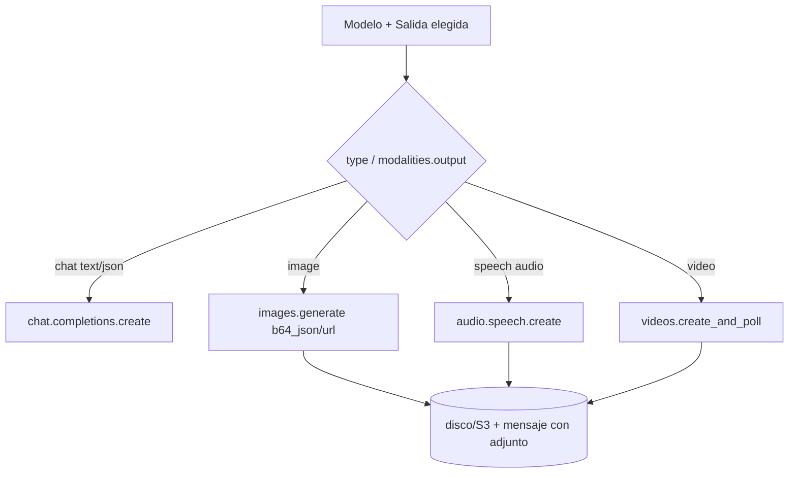

  

---

<h1 align="center">03 — SDK OpenAI y providers OpenAI-compatibles</h1>

---

# 03 — SDK OpenAI (`openai` 3.16.2)

**Tipo**: Especificación de Investigación
**Fecha**: 2026-11-14
**Fuentes consultadas**: Context7 `/openai/openai-python` (3538 snippets), `requirements.txt`, `backend/agent/llm/completion.py`, `backend/agent/utils/provider_keys.py`

## Pregunta de investigación

¿Qué llamadas SDK hay que usar para imagen, TTS/audio y video, y cuáles aplican a los 15 providers OpenAI-compatibles curados?

## Hallazgos

### Hallazgo 1: chat solo sirve para texto (y audio en modelos `gpt-audio`/`realtime`)

- **Detalle**: `client.chat.completions.create(model, messages, ...)` es lo único que usa el repo hoy. Sirve para `type: chat` con `output: ["text"]`. Los modelos `gpt-audio` / `gpt-realtime-*` devuelven texto + audio por el mismo canal de chat (partes de audio en el delta), pero requieren parsear `delta.audio` y no es el camino general para TTS.
- **Fuente**: Context7 `/openai/openai-python` — `chat.completions`; `backend/agent/llm/completion.py:120-171`.
- **Implicancia**: mantener chat para texto/JSON; no forzarlo para TTS/imagen.

### Hallazgo 2: imágenes — `client.images.generate` (endpoint dedicado)

- **Detalle**: llamada dedicada `POST /images/generations` vía `client.images.generate(prompt, model="gpt-image-1", size, n=1-10, response_format="url"|"b64_json", quality, style, output_format png|jpeg|webp)`. Devuelve `ImagesResponse` (lista de `url` o `b64_json`). Modelos `type: image` de `openai` (`gpt-image-1.5`, `gpt-image-2`, `chatgpt-image-latest`) y de `openrouter` (`openai/gpt-5-image*`) usan este camino. Los providers OpenAI-compatibles que exponen `/images/generations` (xAI `grok-imagine-image`, Together, Fireworks) reutilizan el mismo cliente cambiando `base_url` + key.
- **Fuente**: Context7 `/openai/openai-python` — `client.images.generate`, `images.generate (GPT Image generation)`.
- **Implicancia**: implementar `llm_generate_image(prompt, model, size, n, format)` que use `self._openai_clients[provider]` existente; guardar `b64_json` o descargar `url`.

### Hallazgo 3: TTS/audio — `client.audio.speech.create` (endpoint dedicado)

- **Detalle**: `client.audio.speech.create(model="tts-1", voice="alloy", input=text, response_format="mp3"|"opus"|"pcm"|"wav")` y variante streaming `with_streaming_response.create(...)` para primer byte rápido. Ejemplo oficial con `AsyncOpenAI` + `LocalAudioPlayer`. Modelos `tts-1`, `tts-1-hd`, `gpt-4o-mini-tts` y Groq `canopylabs/orpheus-*` (`type: speech`) usan este camino. No pasa por `chat.completions`.
- **Fuente**: Context7 `/openai/openai-python` — `Text-to-speech with streaming response`.
- **Implicancia**: hoy "si pongo un TTS no lo toma" porque el loop lo manda a chat; hay que rutear `type: speech` o `output: ["audio"]` a `audio.speech`.

### Hallazgo 4: video — `client.videos.create` / `create_and_poll` (solo OpenAI Sora y xAI)

- **Detalle**: `client.videos.create(prompt, model="sora-2"|"sora-2-pro", seconds=4|8|12, size="720x1280"|"1280x720"|..., input_reference?)` + `create_and_poll` (crea y espera). Es multipart y asíncrono (job). En `models.dev` aparece para `openai` (Sora) y `xai` (`grok-imagine-video*`), más `alibaba/wan-*` vía OpenRouter/Vertex. La mayoría de los providers curados no lo soportan.
- **Fuente**: Context7 `/openai/openai-python` — `videos.create`, `client.videos.create_and_poll`.
- **Implicancia**: video va último en el roadmap, con polling y almacenamiento de archivo; no bloquear imagen/TTS por video.

### Hallazgo 5: compatibilidad por provider curado

- **Detalle**: los 15 providers OpenAI-compatibles comparten cliente (`AsyncOpenAI(base_url, api_key)`) pero no todos exponen los tres endpoints. Regla práctica: si `GET {base_url}/models` lista el modelo y `models.dev` dice `type: image|speech`, probar el endpoint dedicado; si responde 404, marcar no soportado. Groq ya lista `orpheus` (speech) en su `/models`; xAI lista `grok-imagine-*`.
- **Fuente**: `backend/agent/utils/provider_keys.py:43-144`, `backend/agent/agent.py:115-180`.
- **Implicancia**: la matriz de compatibilidad debe ser por (provider, type), no solo por `api_type`.

## Diagrama de ruteo propuesto (solo OpenAI-compatibles)

## Conclusiones

- Tres llamadas distintas, no una sola con otro parámetro.
- Reutilizar `self._openai_clients` existente minimiza cambios de auth.
- Video es el de mayor costo/latencia; va al final.

## Referencias

- Context7 `/openai/openai-python`: `client.images.generate`, `Text-to-speech with streaming response`, `videos.create`, `client.videos.create_and_poll`
- `backend/agent/llm/completion.py`, `backend/agent/utils/provider_keys.py`

---

Copyright (c) 2026 synapse.ai

---
