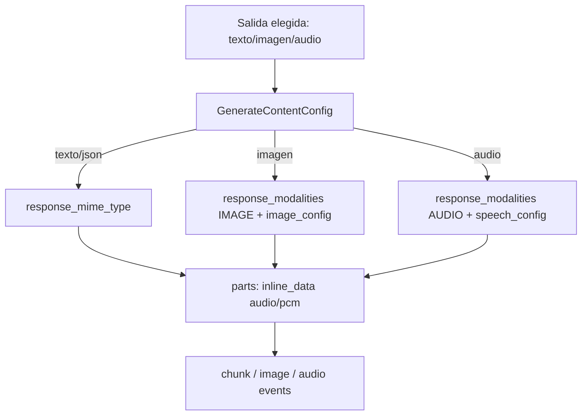

  

---

<h1 align="center">04 — SDK Gemini (`google-genai` 2.24.0)</h1>

---

# 04 — SDK Gemini

**Tipo**: Especificación de Investigación
**Fecha**: 2026-11-14
**Fuentes consultadas**: Context7 `/websites/deepwiki_googleapis_python-genai` (3060 snippets), `backend/agent/llm/completion.py:233-297`, `backend/agent/llm/streaming.py:446-541`

## Pregunta de investigación

¿Cómo genera Gemini imagen, audio/TTS y video desde Python, y qué cambia respecto al `generate_content` que usamos hoy?

## Hallazgos

### Hallazgo 1: `generate_content` ya puede devolver imagen/audio si se pide `response_modalities`

- **Detalle**: `GenerateContentConfig` tiene `response_modalities: list[Modality]` (`TEXT`, `IMAGE`, `AUDIO`), además de `response_mime_type`, `image_config` y `speech_config`. Hoy el repo solo setea `temperature`, `top_p`, `max_output_tokens`, `system_instruction`, `tools` y `response_mime_type`. Sin `response_modalities`, Gemini devuelve solo texto aunque el modelo soporte imagen/audio. La respuesta trae `parts` con `text` o `inline_data` (bytes base64 + `mime_type`).
- **Fuente**: Context7 — `GenerateContentConfig` (Output Control + Media and Speech).
- **Implicancia**: para `gemini-3-pro-image`, `gemini-2.5-flash-image` hay que pasar `response_modalities=["TEXT","IMAGE"]` (o `["IMAGE"]`) y parsear `inline_data`, no `response.text`.

### Hallazgo 2: imagen — `response_modalities=["IMAGE"]` + `image_config`

- **Detalle**: modelos `type: image` (`gemini-3-pro-image`, `gemini-2.5-flash-image`, `gemini-2.5-flash-image` vía Vertex) generan imagen como `part.inline_data.data` (bytes) con `mime_type: image/png`. `image_config` controla aspecto/tamaño según modelo. El streaming (`generate_content_stream`) entrega las partes igual que el no-streaming; el repo ya itera `candidate.content.parts` y distingue `function_call` vs `text`, pero ignora `inline_data`.
- **Fuente**: Context7 — `GenerateContentConfig.image_config`; `backend/agent/llm/streaming.py:503-528`.
- **Implicancia**: agregar rama `inline_data` → guardar bytes → emitir evento `image` al frontend.

### Hallazgo 3: TTS/audio — `speech_config` + `response_modalities=["AUDIO"]` (no-Live) y Live API para realtime

- **Detalle**: dos caminos: a) no-streaming/streaming clásico con `speech_config=SpeechConfig(voice_config=VoiceConfig(prebuilt_voice_config=PrebuiltVoiceConfig(voice_name)))` y `response_modalities=["AUDIO"]` (modelos `gemini-2.5-flash-preview-tts`, `gemini-2.5-pro-tts`); b) Live API (`aio.live.connect(model="gemini-live-2.5-flash-preview", config=LiveConnectConfig(response_modalities=["AUDIO","TEXT"], speech_config, realtime_input_config, input/output_audio_transcription))`) para `type: realtime` (`gemini-3.1-flash-live-preview`, `qwen3-omni-flash-realtime`). El repo no usa ninguno de los dos.
- **Fuente**: Context7 — `Complete LiveConnectConfig with speech...`, `Configure response modalities`, `Response Modalities and Media Configuration`.
- **Implicancia**: TTS simple va por (a); voz conversacional va por (b) y es un proyecto aparte (WebSocket, interrupciones).

### Hallazgo 4: video (Veo) — fuera del `generate_content` actual

- **Detalle**: video en Gemini (Veo) usa endpoint de jobs (`veo` / `predict` long-running), no `generate_content`. En `models.dev` los videos de Google aparecen vía `google-vertex` y `vercel`/`qiniu-ai` como proxies, no como `google` directo. Con la key de AI Studio actual no hay video directo.
- **Fuente**: `models.dev` (37 modelos `google`: ningún `output: ["video"]`), Context7 GenAI (sin `videos` en `GenerateContentConfig`).
- **Implicancia**: no prometer video de Google en fase 1; solo imagen + TTS.

### Hallazgo 5: cambios mínimos en el código actual

- **Detalle**: `completion.py` y `streaming.py` ya construyen `GenerateContentConfig(**config_kwargs)` y ya iteran `parts`. Agregar `response_modalities`, `speech_config`, `image_config` es aditivo. El `usage_metadata` ya cuenta `thoughts_token_count`; para audio/imagen hay que revisar si `candidates_token_count` cubre los tokens de medios (costos distintos en `models.dev`).
- **Fuente**: `backend/agent/llm/completion.py:233-297`, `backend/agent/llm/streaming.py:446-541`.
- **Implicancia**: el riesgo es bajo si se encapsula en un traductor `translate_output(provider, model, output)` análogo a `translate_reasoning`.

## Diagrama

## Conclusiones

- Gemini es el provider más directo para imagen + TTS porque no requiere endpoints nuevos, solo config + parseo.
- Live/realtime es fase posterior.
- Video de Google no va en fase 1.

## Referencias

- Context7 `/websites/deepwiki_googleapis_python-genai`: `GenerateContentConfig`, `Configure response modalities`, `Complete LiveConnectConfig...`
- `backend/agent/llm/completion.py`, `streaming.py`

---

Copyright (c) 2026 synapse.ai

---
