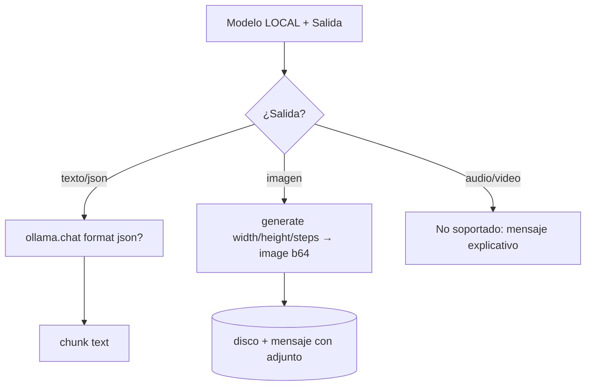

  

---

<h1 align="center">05 — SDK Ollama local (`ollama` 0.6.2)</h1>

---

# 05 — SDK Ollama

**Tipo**: Especificación de Investigación
**Fecha**: 2026-11-14
**Fuentes consultadas**: Context7 `/ollama/ollama-python` (441 snippets) y `/ollama/ollama` (4177 snippets), `backend/agent/utils/model_resolver.py`, `backend/agent/llm/completion.py:173-232`

## Pregunta de investigación

¿Qué puede generar Ollama local además de texto, y cómo se llama desde Python?

## Hallazgos

### Hallazgo 1: chat y generate son solo texto (+ `thinking`), salvo modelos de imagen

- **Detalle**: `AsyncClient.chat(model, messages, tools, format, options, think)` y `chat(stream=True)` devuelven `message.content` (+ `thinking`, `tool_calls`). Es lo que usa el repo. No hay TTS nativo en Ollama.
- **Fuente**: `backend/agent/llm/completion.py:173-232`, `backend/agent/llm/streaming.py:249-444`.
- **Implicancia**: para LOCAL, el desplegable debe ofrecer Texto/JSON siempre, e Imagen solo si el modelo la soporta.

### Hallazgo 2: imagen — `generate` con `width`/`height`/`steps` devuelve `image` base64

- **Detalle**: `POST /api/generate` acepta `width`, `height`, `steps` (parámetros de difusión) y responde `GenerateResponse(image: base64, completed/total)` en streaming. En Python: `client.generate(model, prompt, width, height, steps)` o `AsyncClient.chat` según familia. Aplica a modelos de imagen servidos por Ollama (p. ej. familias de difusión empaquetadas para Ollama). El repo nunca pasa `width`/`height`/`steps` y descarta `response.message` que no sea `content`/`tool_calls`.
- **Fuente**: Context7 `/ollama/ollama-python` — `GenerateResponse`, `POST /api/generate`, `generate()`.
- **Implicancia**: implementar `llm_generate_image_ollama` que pruebe `generate` con dimensiones y lea `image`; si el modelo no es de imagen, cae a chat de texto.

### Hallazgo 3: entrada de imagen sí existe, salida de imagen no se anuncia

- **Detalle**: `generate`/`chat` aceptan `images: [base64]` como entrada multimodal, y `/api/show` devuelve `capabilities: ["vision"]` para esos modelos. Pero `capabilities` no distingue "entiende imágenes" de "genera imágenes". Hoy `model_resolver` mapea `vision → input: ["text","image"], output: ["text"]`.
- **Fuente**: `backend/agent/utils/model_resolver.py:340-377`.
- **Implicancia**: no se puede derivar la salida de imagen LOCAL solo de `capabilities`; hace falta lista curada o prueba en vivo.

### Hallazgo 4: sin TTS/video nativo

- **Detalle**: no hay endpoint `audio.speech` ni `videos` en la API de Ollama. TTS local requeriría otro servicio (p. ej. Piper/XTTS) fuera del alcance de esta fase.
- **Fuente**: Context7 `/ollama/ollama` y `/websites/ollama_api` (endpoints: `generate`, `chat`, `embeddings`, sin audio/video).
- **Implicancia**: para LOCAL, el desplegable ofrece Texto/JSON (+ Imagen solo si el modelo la soporta); Audio/Video se muestran deshabilitados con motivo.

## Diagrama

## Conclusiones

- Ollama aporta poco a la fase 1 salvo no romper lo existente.
- Imagen local es oportunista (solo si el modelo la soporta).
- TTS/video local quedan fuera de fase 1.

## Referencias

- Context7 `/ollama/ollama-python`: `GenerateResponse`, `POST /api/generate`, `generate()`
- `backend/agent/utils/model_resolver.py`, `backend/agent/llm/completion.py`

---

Copyright (c) 2026 synapse.ai

---
