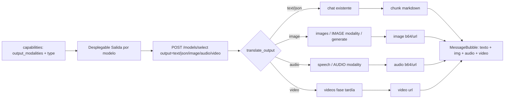

  

---

<h1 align="center">06 — Propuesta de diseño: desplegable de salida y plan por fases</h1>

---

# 06 — Propuesta de diseño

**Tipo**: Especificación de Investigación
**Fecha**: 2026-11-14
**Rama**: `feat/outputs`

## Pregunta de investigación

¿Cómo debe verse y comportarse el desplegable de "tipo de salida" y qué cambios mínimos lo hacen posible sin romper texto/JSON?

## Hallazgos

### Hallazgo 1: el desplegable debe derivarse de `output_modalities` + `type`, no de valores fijos

- **Detalle**: hoy "Salida" ofrece Default/Texto/JSON fijo. La propuesta es poblarlo por modelo: leer `GET /models/capabilities` (ya devuelve `output_modalities`, falta agregar `type`) y mapear: `text → Texto`, `structured_output → JSON`, `image → Imagen`, `audio → Audio/TTS`, `video → Video`. Si el modelo es `type: speech` con `output: ["audio"]`, el desplegable muestra solo Audio (+ Default). Si es `type: image` con `["image","text"]`, muestra Texto/Imagen. Texto siempre disponible como fallback salvo modelos puros (`output: ["image"]` o `["audio"]`).
- **Fuente**: `02-models-dev-outputs.md`, `frontend/src/components/configTab.tsx:901-921`.
- **Implicancia**: sin este mapeo el usuario seguirá pudiendo pedir TTS a un modelo de texto y fallará.

### Hallazgo 2: validación backend por (provider, model, salida)

- **Detalle**: `POST /models/select` ya valida `reasoning` y `response_format` contra el catálogo. Hay que extenderlo a `output: text|json|image|audio|video` con la misma filosofía: si `supports` es `False`, error 400 con mensaje; si es `None` (desconocido), dejar pasar con warning. Requiere exponer `type` en `get_reasoning_options` y sincronizar `?type=image|s speech` (ver `02`).
- **Fuente**: `backend/routes/config/models.py:228-287`, `backend/agent/loop/agent_loop.py:325-357`.
- **Implicancia**: evita que el loop intente chat con un modelo de imagen pura.

### Hallazgo 3: ruteo en el loop por familia SDK

- **Detalle**: el loop hoy llama siempre a `llm_streaming` (chat). La propuesta es un ruter `translate_output(provider, model, output)` análogo a `translate_reasoning`: `text|json → chat` (sin cambios), `image → images.generate` (OpenAI-compatibles) o `response_modalities IMAGE` (Gemini) o `generate width/height` (Ollama), `audio → audio.speech` o `speech_config AUDIO`, `video → videos.create_and_poll` (solo donde exista). Cada rama devuelve bytes + metadatos, no solo `str`.
- **Fuente**: `03-sdk-openai.md`, `04-sdk-gemini.md`, `05-sdk-ollama.md`.
- **Implicancia**: el cambio es aditivo; el camino de texto queda intacto.

### Hallazgo 4: streaming, persistencia y render multimodal

- **Detalle**: hacen falta nuevos eventos SSE (`image`, `audio`, con `url` o `b64` + `mime`), guardado en disco (p. ej. `store/outputs/<session>/<turn>.<ext>`) y render en `MessageBubble` (``, `<audio controls>`, `<video controls>`). Los costos (`spend_handler`, `calculate_cost`) hoy leen `cost_input/cost_output` por tokens; imagen/audio/video se facturan por imagen/segundo/carácter según provider — hay que registrar `cost_basis` por salida.
- **Fuente**: `01-estado-actual.md` Hallazgo 4, `backend/agent/utils/spend_handler.py`.
- **Implicancia**: sin esto la imagen/TTS "funciona" en backend pero el usuario no la ve.

### Hallazgo 5: matriz de compatibilidad inicial (foto 2026-11-14)

| Provider | Texto/JSON | Imagen | Audio/TTS | Video | Camino SDK |
|---|---|---|---|---|---|
| `openai` | Sí | Sí (`gpt-image-*`) | Sí (`tts-1`, `gpt-audio`) | Sí (Sora, fase tardía) | `chat` / `images.generate` / `audio.speech` / `videos` |
| `openrouter` | Sí | Sí (`gpt-5-image*`, `flux`, `recraft`) | Sí (`gpt-audio`, `orpheus`) | Sí (varios, fase tardía) | mismo cliente OpenAI con `base_url` OpenRouter |
| `google` | Sí | Sí (`gemini-*-image`) | Sí (`*-tts`, `live`) | No (fase 1) | `generate_content` + `response_modalities`/`speech_config`/`image_config` |
| `groq` | Sí | No | Sí (`orpheus-*`, `type: speech`) | No | `audio.speech` vía base Groq |
| `xai` | Sí | Sí (`grok-imagine-image*`) | No | Sí (`grok-imagine-video*`, fase tardía) | `images.generate` / `videos` vía base xAI |
| `mistral` | Sí | No | Sí (`voxtral-mini-tts`) | No | `audio.speech` vía base Mistral |
| `alibaba` | Sí | No (fase 1) | Sí (`qwen-omni`, realtime) | No (fase 1) | `chat` + audio realtime (fase tardía) |
| `deepseek`, `togetherai`, `fireworks-ai`, `cerebras`, `perplexity`, `meta`, `moonshotai`, `zhipuai` | Sí | No | No | No | sin cambios |
| `LOCAL` (Ollama) | Sí | Oportunista (`generate width/height`) | No | No | `chat` / `generate` |

## Diagrama de diseño propuesto

## Plan por fases (propuesto, a validar)

1. **Fase 0 — Catálogo**: sincronizar `?type=image` y `?type=speech`, exponer `type` en `GET /models/capabilities`, sin cambiar el loop.
2. **Fase 1 — Desplegable**: poblar "Salida" desde `output_modalities` + `type`; validación en `POST /models/select`; Texto/JSON intactos.
3. **Fase 2 — Imagen**: `images.generate` (OpenAI-compatibles) + `response_modalities IMAGE` (Gemini) + `generate` (Ollama oportunista); eventos SSE + render `` + guardado en disco.
4. **Fase 3 — TTS/Audio**: `audio.speech` + `speech_config AUDIO`; render `<audio>`; voces por modelo.
5. **Fase 4 — Video**: solo `openai`/`xai`/`openrouter`; jobs + polling + render `<video>`.
6. **Fase 5 — Costos y Telegram**: `spend_handler` por salida; reenvío de binarios por `telegram/transport`.

## Riesgos

- Endpoints dedicados pueden devolver 404 aunque `models.dev` anuncie el modelo (probar por provider).
- Binarios grandes (imagen/video) exigen límite de tamaño y limpieza.
- Costos de imagen/audio/video no son por token; mal estimados distorsionan métricas.
- Live/realtime (voz conversacional) es un proyecto aparte (WebSocket), no entra en TTS simple.

## Conclusiones

- Empezar por catálogo + desplegable da valor sin riesgo (no toca el loop).
- Imagen y TTS son independientes y pueden ir en paralelo por provider.
- Video va al final.

## Referencias

- `01-estado-actual.md`, `02-models-dev-outputs.md`, `03-sdk-openai.md`, `04-sdk-gemini.md`, `05-sdk-ollama.md`
- Context7: `/openai/openai-python`, `/websites/deepwiki_googleapis_python-genai`, `/ollama/ollama-python`

---

Copyright (c) 2026 synapse.ai

---
