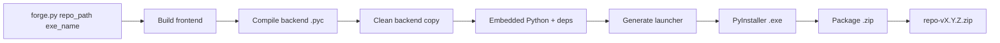

<p align="center">
  
</p>

---

<h1 align="center">synapseForge / launch</h1>

---

<p align="center">
  <a href="./LICENSE">
    
  </a>
</p>

---

<h3 align="center">Distribución automatizada de agentes IA full-stack en un solo comando</h3>

---

## Descripción

**launch** es el módulo de empaquetado de synapseForge. Toma un proyecto de agente (backend FastAPI + frontend React/Vite) y genera un archivo `.zip` listo para distribuir, que incluye:

- Ejecutable `.exe` lanzador (sin consola, abre el navegador automáticamente)
- Backend como fuentes `.py` o, con `--compile`, compilado a `.pyc` (sin código fuente expuesto)
- Frontend compilado (`frontend/dist/`)
- Python embebido (carpeta `python/` con las dependencias de `requirements.txt` instaladas)
- `.env`, `LICENSE`, `README.md`

**Resultado:** un solo `.zip` que el usuario final descomprime y ejecuta con doble click. Sin instalar Python, sin pip, sin npm.

El empaquetado es para Windows: el lanzador es un `.exe` de PyInstaller y el Python embebido es el de Windows (amd64).

---

## ¿Qué resuelve?

- **Distribución repetitiva**: automatiza compilación, empaquetado y exclusión de archivos innecesarios
- **Sin exposición de código fuente (opcional)**: con `--compile` compila a `.pyc` y excluye los `.py` originales
- **Portabilidad total**: incluye Python embebido, no requiere runtime externo
- **Cero configuración para el usuario**: descomprime y ejecuta

---

## Requisitos

| Herramienta | Versión | Uso |
|-------------|---------|-----|
| **Python** | 3.12+ | Entorno del proyecto a empaquetar |
| **Node.js** | 20+ | Build del frontend (npm) |
| **PyInstaller** | 6+ | Generación del ejecutable |

---

## Instalación

```bash
>>> cd pipeline/launch
>>> pip install -r requirements.txt
```

---

## Uso

Desde la CLI:

```bash
>>> synapseForge launch -p <ruta_al_proyecto> -n "<nombre_del_ejecutable>"
```

O directamente con el script:

```bash
>>> python pipeline/launch/forge.py <ruta_absoluta_al_repo> "<nombre_del_ejecutable>"
```

### Ejemplos

```bash
# Proyecto en el directorio actual
>>> synapseForge launch -n "Mi Agente"

# Windows, ruta explícita
>>> synapseForge launch -p D:\proyectos\mi-agente -n "Mi Agente"

# Saltar build del frontend (usar dist/ existente)
>>> synapseForge launch -p D:\proyectos\mi-agente -n "Mi Agente" --skip-frontend

# Compilar el backend a .pyc
>>> synapseForge launch -p D:\proyectos\mi-agente -n "Mi Agente" -c
```

### Argumentos

| Argumento | Obligatorio | Descripción |
|-----------|-------------|-------------|
| `-p`, `--path` (CLI) / `repo_path` (script) | CLI: ❌, script: ✅ | Ruta al directorio raíz del proyecto. En la CLI es el directorio actual por defecto |
| `-n`, `--name` (CLI) / `exe_name` (script) | ✅ | Nombre del ejecutable (con o sin .exe) |
| `--skip-frontend` | ❌ | Salta `npm install` y `npm run build` (usa frontend/dist/ existente) |
| `--no-embed` | ❌ | Omite el Python embebido: el zip sale sin la carpeta `python/`, que el lanzador busca junto al ejecutable |
| `-c`, `--compile` | ❌ | Compila el backend a `.pyc` y excluye los `.py`. Sin esta opción el backend se distribuye como fuentes `.py` |

---

## Pipeline



La compilación a `.pyc` solo corre con `--compile`; el Python embebido se omite con `--no-embed`; el build del frontend se omite con `--skip-frontend`.

### Pasos detallados

1. **Build frontend** — ejecuta `npm install` y `npm run build` con `VITE_MODE=prod` en `repo/frontend/`
2. **Compilar backend** (`--compile`) — `python -m compileall -b backend/` → genera `.pyc` legacy junto a cada `.py`
3. **Limpiar copia** — copia `backend/` excluyendo:
   - `__pycache__/`
   - `agent.db`
   - Todos los `.md` y `.txt` excepto en `agent/prompts/`
   - Los `.py` si se compiló, o los `.pyc` si no
4. **Python embebido** — descarga Python 3.12.0 embebido (queda cacheado en `pipeline/launch/.cache/`), instala pip y las dependencias de `requirements.txt` del proyecto
5. **Generar launcher** — personaliza `templates/launcher.py` con el módulo (`backend.main:app`), el puerto (`8000`) y el nombre del ejecutable
6. **Compilar ejecutable** — PyInstaller `--onefile --noconsole` → `{exe_name}.exe`
7. **Empaquetar** — crea `{repo}-v{version}.zip` con:
   - `{exe_name}.exe`
   - `backend/` (`.py`, o `.pyc` con `--compile`)
   - `frontend/dist/`
   - `python/` (Python embebido + deps)
   - `.env`, `LICENSE`, `README.md`

La versión sale de `frontend/package.json` (`0.1.0` si no existe).

---

## Estructura del módulo

```plaintext
pipeline/launch/
├── forge.py                         # Orquestador del build
├── templates/
│   └── launcher.py                  # Template del ejecutable lanzador
├── requirements.txt                 # Dependencias (pyinstaller)
├── .cache/                          # Python embebido y get-pip.py descargados
└── README.md                        # Este archivo
```

---

## Output del build

```
{repo}/__forge_build__/
├── launcher.py                      # Launcher generado (temporal)
├── temp/                            # PyInstaller workpath (autolimpieza)
├── dist/
│   ├── {exe_name}.exe
│   ├── backend/                     # Backend limpio
│   └── python/                      # Python embebido + deps
└── {repo}-v{version}.zip            # Producto final
```

El `.zip` final se mueve a la raíz del repositorio y `__forge_build__/` se borra.

---

## Convención de repositorios

Para que **launch** funcione correctamente, el repositorio debe seguir esta estructura:

```plaintext
{repo}/
├── backend/                         # FastAPI
│   ├── main.py                      # Entry point (backend.main:app)
│   ├── agent/                       # Lógica del agente
│   │   └── prompts/                 # .md/.txt acá se conservan
│   └── routes/                      # Endpoints
├── frontend/
│   ├── package.json                 # Define la versión del zip
│   └── dist/                        # Generado por npm run build
├── requirements.txt                 # Dependencias del Python embebido
├── .env                             # Configuración
├── LICENSE
└── README.md
```

---

## Licencia

Apache 2.0 — Ver archivo [LICENSE](../LICENSE)

---

Copyright (c) 2026 SYNAPSE AI SAS

---
